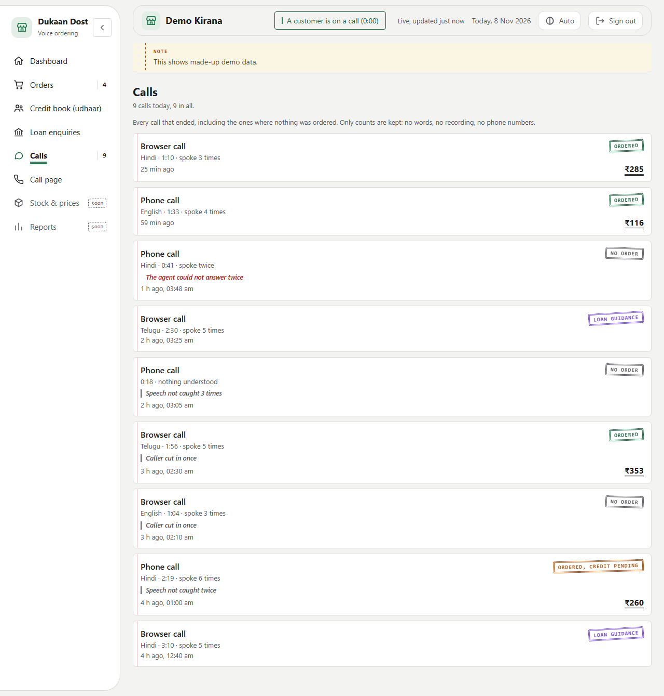
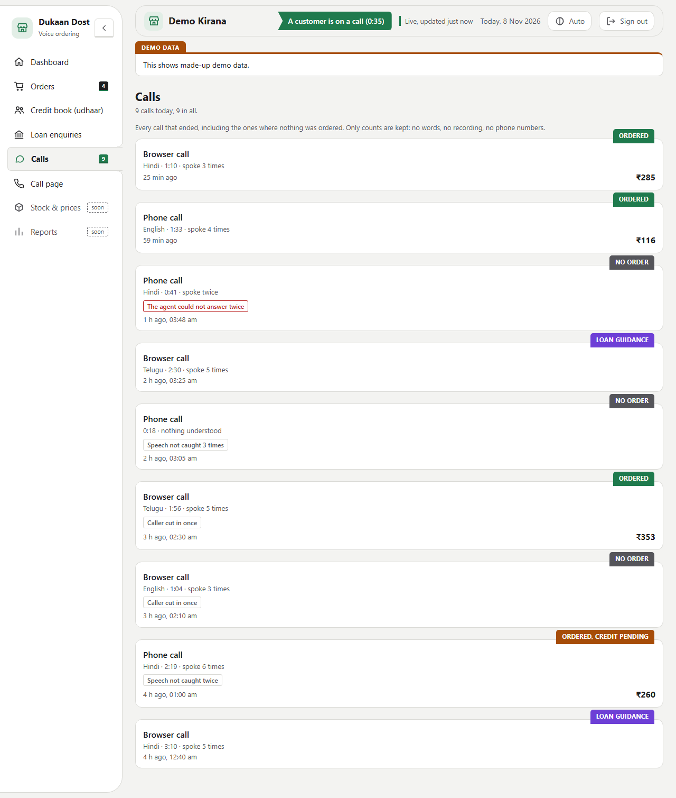
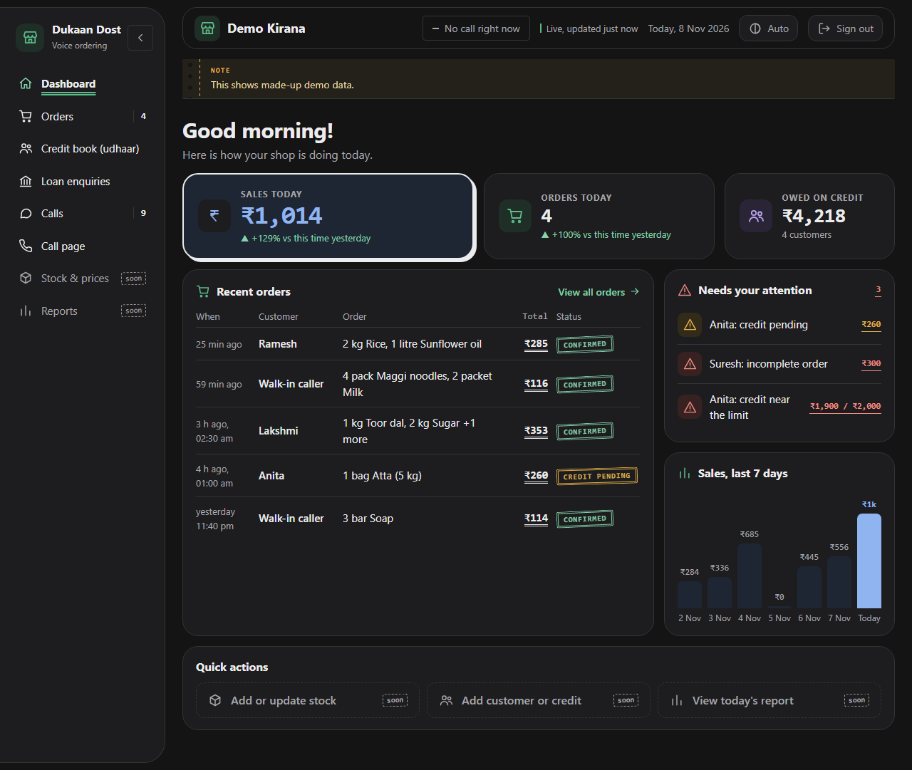
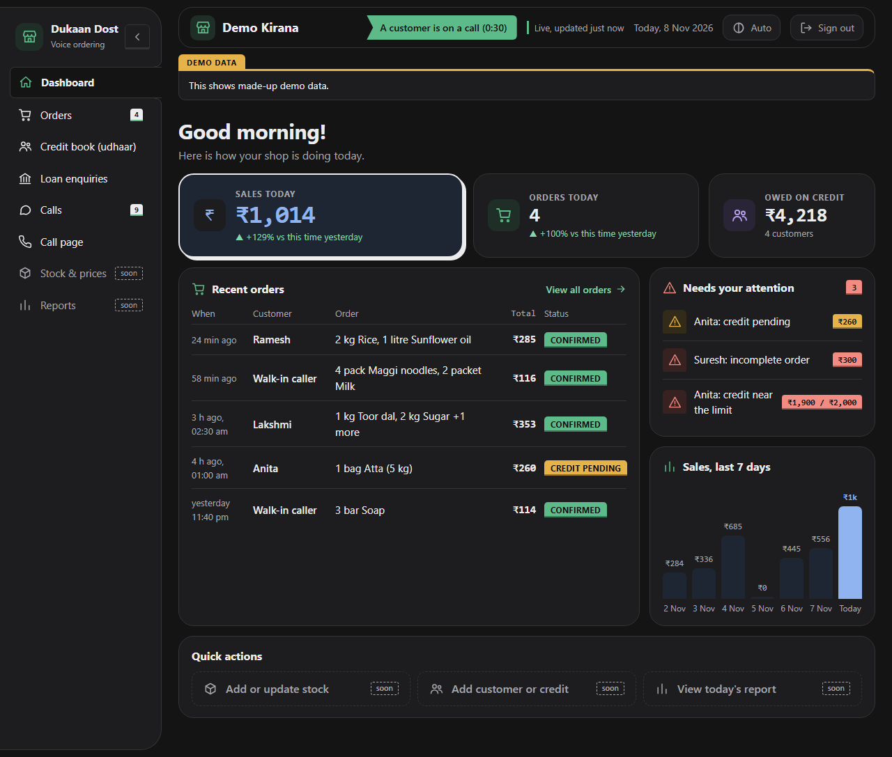
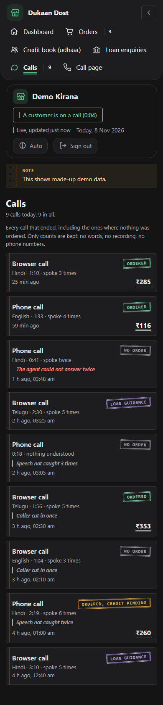
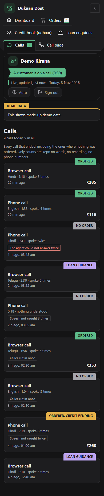

# Frontend

Three pages, all served by the agent on one port. Two exist; the admin one is planned.

| Page | Address | Who | Status |
|---|---|---|---|
| Call page | `/s/<shop>/` (and `/` for the default shop) | The caller | Built (Build 1002) |
| Shopkeeper dashboard | `/s/<shop>/dashboard` | The shop's owner, with the shop's PIN | Built (Build 1003) |
| Admin dashboard | `/admin` | You, with the admin password | Built (DEC-042): overview, problems, add a shop, edit a shop, activity |

## Design system (both pages)
One palette, chosen 2026-11-02: solid cards on a soft page, **Kirana Green** `#16803D` as the brand colour, blue for sales and "processing", violet for credit (udhaar), amber for pending, red for errors and the end-call button (`#DC2626`). Status is always a coloured pill **with a label**, never colour alone. Cards have a 14 px radius, buttons 9 px, a 1 px `#E2E8F0` border and a very light shadow; no gradients. Dark themes follow the device. Text is Inter when installed, otherwise the system font (the pages load nothing from outside, so Inter cannot be fetched). The tokens live in `components/shared/tokens.css`, one copy for both pages.

## UI rules, learned from an earlier project's frontend guide (2026-11-02)
Taken as principles, not content, and each one checked against these two pages first. What was already right: colours as tokens, status as a labelled pill, three kinds of empty (waiting, none, not available), server text shown as text only, reduced motion handled.

Changed because of it:
- **A theme control on every page.** Auto, Light, Dark; the choice is remembered (`dd:theme`) and applied by a small script in `<head>` before the CSS, so there is no flash. Before this the pages followed only the device, so a change to the light theme was invisible on a dark device. Press `T`.
- **Loading is not "nothing here".** The dashboard shows placeholder blocks until the first answer, and marks `main` busy; the empty-state messages are only for data that really is empty. A week with no sales shows one empty message, not seven zero bars.
- **Compare like with like.** "vs yesterday" now compares today so far with yesterday up to the same time of day (`*_yesterday_same_time` in the snapshot), and says "vs this time yesterday". Older servers fall back to the whole of yesterday.
- **Focus never falls to the page.** When Start call becomes End call, focus moves to the new button; when a dashboard section changes, focus moves to its heading.
- **Keys:** `M` mutes during a call, `T` changes the theme; both ignore typing, held keys and Ctrl/Alt/Cmd chords, and the key is shown in the control's tooltip.
- **Touch targets** are 44 px on a coarse pointer.
- **Every colour is a token**, including the text on the green and red buttons. A test fails if a colour is written anywhere else in either page.

Rules to keep:
1. A rule that has been decided gets a check in the same change (the colour test is the model). A check must be seen to **fail** once: the first version of that test could never fail, because an escape turned `` into a backspace byte, and it passed on every run until a stray colour was injected on purpose.
2. Show only what the data supports: a missing value is a dash or a stated reason, never a placeholder that looks like a reading.
3. State that the user chose lives in one place and survives navigation; everything else stays local.
4. Every piece of the interface is a component with one home (see Component structure).

Not taken: a router, a state library, lazy-loaded screens, a status page and a build-label dialog. They solve problems these two small pages do not have yet.

## The visual mix: bento, brutalist accents, minimal (DEC-041, glass removed by DEC-049)
Glass and the coloured glows were taken out on 2026-11-05 (DEC-049): every page now uses one neutral charcoal and off-white palette, with one calm green accent, flat solid surfaces and no gradients. The text below that still says glass is history; the working rules are these three ideas, each with one job so they do not fight:

| Idea | Its job | Where it lives |
|---|---|---|
| **Bento** | The layout: unequal cells on a 12-column grid, one hero | `dashboard/layout.css` (the overview), `call/layout.css`; panels carry `b-*` classes |
| ~~Glass~~ | Removed (DEC-049): no blur, no blobs, no `--glass`/`--blob` tokens, no `shared/glass.css` | |
| **Brutalist accents** | The few things that matter most: a thick border and a hard offset shadow that presses in on click (the call button, End call, the hero number); monospace numerals; small uppercase labels | `shared/brutal.css` (class `brut`); `--mono`, `--brut`, `--hard-shadow` |
| **Minimal** | The base: one 22 px radius, generous gaps, no shadows on ordinary cells, nothing decorative beyond the above | `shared/tokens.css` |

- **The side menu is a drawer** (2026-11-02): a floating panel with a large curved right end, coming out from the left edge. A chevron button inside it hides it (it slides out and the page widens); a panel icon in the top bar brings it back; `B` does both. The choice is remembered (`dd:menu`) and applied by a small script in `<head>` before the CSS, so there is no flash. While hidden the menu leaves the tab order, and focus moves to the button that replaces the one pressed. On a phone the menu row is hidden entirely and the same icon brings it back. Components: `dashboard/side-menu.*`, `dashboard/menu.js`, `dashboard/menu-init.html`.
- **The hero tile is one row, not two:** the Sales tile is the widest and has the biggest number but is no taller than its neighbours; a first version two rows tall was mostly empty. The three tiles are one row on a laptop, and the check for sideways scrolling is run at 1440, 1280, 1100, 1001, 900, 600, 390 and 360 px, menu open and hidden.

Rules that keep the mix honest:
1. **Every surface is solid.** No glass, no gradient, no blur (a test on the admin page and the contrast tool's exact arithmetic both rely on this).
2. **Brutalism is an accent, never the base.** Use `brut` on at most the one call to action and the one hero figure per screen. It respects reduced motion (the press animation only runs when motion is allowed).
3. **One hero per page.** On the dashboard it is Sales today (tall, blue, hard-edged); on the call page it is the call card.
4. **Colours still come only from tokens.** The brutalist ink is a token in each theme (near-black in light, near-white in dark, so the hard shadow is never the same colour as the green button it sits under). The colour test covers the new files.
5. **Cells dissolve into the grid.** On the dashboard the old wrappers (`.cols`, `.stack`, the tile row) are `display:contents` so each cell is placed directly by its `b-*` class. Phone: two columns, then one, hero first.

## Component structure (DEC-040)
Everything on the two pages is a **component**: one small file with one job, composed into a page. A page file (`dukaan_dost/web/index.html`, `dashboard.html`) is only a list of the components it is made of plus its own controller; the pieces live in `dukaan_dost/web/components/`. The server stitches them together on every request (`dukaan_dost/webpage.py`, `{{include:path}}`), so each page still arrives as **one self-contained response** and the dashboard's strict content security policy (no outside files) is unchanged.

Levels, from the smallest piece up:

| Level | What it is | Where | Examples |
|---|---|---|---|
| **Tokens** | The colours, radii and shadow. The only place a colour is written. | `shared/tokens.css` | light, device-dark, chosen-dark |
| **Atoms** | One visual idea, no layout of its own | `shared/atoms.css`, `shared/base.css`, `shared/icons.html` | `.mark`, `.chip`, `.dot`, `.tag`, `.soon`, `.empty`, the icon sheet |
| **Molecules** | A few atoms that work together | `shared/panel.css`, `shared/brand.html`, `shared/theme-button.*`, `dashboard/status-pill.css`, `dashboard/icon-tile.css` | panel with its heading row, the brand block, the theme button, the status pill |
| **Organisms** | A whole panel: its markup, its styles and its script, side by side | `dashboard/recent-orders.*`, `dashboard/stat-tiles.*`, `dashboard/attention.*`, `dashboard/sales-trend.*`, `call/call-card.*`, `call/transcript.*`, `call/order-panel.*` | "Recent orders", the four number tiles, the live transcript |
| **Pages** | The list of organisms and the controller that feeds them | `index.html`, `dashboard.html` | the call page, the dashboard |

An organism is up to three files with the same name: `x.html` (markup), `x.css` (styles), `x.js` (the function that draws it). **Pure helpers** (formatting, labels, the "needs attention" rule) sit in `helpers.js` files between the `helpers` markers in the page script, so Node tests can run them without a browser.

Rules:
1. **One home per piece.** If two pages need the same thing it goes in `shared/`; a piece used by one page lives under that page's folder. The theme button, the brand block, the colour tokens, the icon sheet, the DOM builder `h()`, the formatters and the shortcut check used to be written twice; each now exists once.
2. **A component is one kind of thing** (markup, styles *or* script) and never holds its own `<script>` or `<style>` tag; the page owns those. A test fails otherwise.
3. **No orphans, no holes.** A test fails if a component file is used by no page, or if a page asks for one that does not exist. A missing component is a build error, never a silent gap.
4. **Names do not collide in meaning.** A class means one thing everywhere: the call page's order total is `.order-total` (the dashboard's `.total` is a different thing), its shop pill is `.shop-chip` (the dashboard's `.shop` is a different thing).
5. **Change a token, change it in `shared/tokens.css` only.** Pages no longer have their own copies to keep identical (this used to be a manual rule and is now structural).
6. **Look before and after a split.** The refactor was checked by comparing the CSS rule by rule (128 of the dashboard's 143 rules byte-identical, the rest the deliberate merges), by screenshots of the same states, and by pulling a stray colour into each kind of component to see the colour test fail.

What the split changed on screen, on purpose: the logo mark is 40 px on both pages (was 42 on the call page), the brand subtitle is "Voice ordering" on both (so the shop name sits beside the logo on a phone), the call page's cards use the same panel as the dashboard's, and empty states use one padding.

Adding a component: write `components/<page or shared>/<name>.{html,css,js}`, add its `{{include:...}}` line to the page, and run `python -m pytest tests/test_webpage.py` and `node --test tests/web/`. See the page output with `python -m dukaan_dost.webpage index` or `dashboard`.

## The call page
`dukaan_dost/web/index.html` (a template; components under `components/call/`). A call screen on the left, what the caller needs beside it. The shared palette below, with a matching dark theme; icons are inline SVG because the pages load nothing from outside.
- **The call screen:** a status chip with the call timer, the language heard so far, a shop mark, a large state line, a waveform, and the controls. **Start call** becomes **End call**; **Mute** appears during a call.
- **States** (worked out by the page itself from what it is doing): listening (the waveform follows the caller's own microphone), thinking (after the caller's words arrive, until the first reply clip; given up after 12 s because not every turn gets a spoken reply), speaking (the waveform follows the agent's voice), muted, ended.
- **Live transcript:** what the caller said and what the agent said, one bubble per reply. A reply cut off by the caller is marked "(interrupted)". The agent's text is shown when it is queued for speech, a moment before it is heard.
- **Current order:** read-only (the caller changes the order by voice; totals are computed in code). It shows "coming soon" until the agent sends `order` messages, which waits for the order state (build step 8, DEC-006).
- **Loan guidance** (added 2026-11-03): sits under the order. Empty it says "Ask about a business loan and the figures appear here". After each quote the agent sends a `loan` event and the panel shows, in the calculator's own words: where (business and place, if said), the project cost, the caller's margin money, the loan, the scheme and its rate, the total interest, and a highlighted **instalment a month for N months, after an M-month moratorium**. If the loan is capped it says the caller puts in more than the margin. If the project is above the scheme's limit it shows no loan and no instalment and says no scheme applies. A new quote replaces the old one in place; the last quote stays after the call ends and is cleared when the next call starts. It is always tagged **indicative** and carries a footnote that the figures come from the scheme terms this project uses, not a bank or the government (DEC-047: the scheme figures could not be verified). **The page shows only the figures it is given and does no arithmetic**: a test checks that the panel code has none, and another that a changed instalment is shown as sent and not recomputed. Amounts are in monospace, text in the normal font.
- **Plain messages** for the common failures: a page that is not `localhost` or `https` (no microphone), permission denied, the agent not running, another call in progress.
- **Not taken from the mockup:** a speaker button (meaningless in a browser tab), a language picker (Prisma detects the language and the app locks it for the call), +/- buttons on order lines.
- **New protocol messages**, server to page: `user` (`text`, `lang`), `agent` (`reply`, `text`), `order` (`items`, `total`), `loan` (the calculator's figures plus `business`, `place`, `heard_amount`, `kind`, `indicative`). Sent through `Transport.send_event`, which never blocks the call. Listed at the top of `transport_websocket.py`.
- **Everything the server sends is shown as text, never as HTML**, and a Node test fails if `innerHTML` and friends appear.
- Needs `localhost` or `https`. **Still not tried with a real microphone in a real browser** (B-08). Checked as a render in headless Chrome at 1280, 700 and 390 px wide, light and dark, with the states driven by script: no horizontal overflow.

## The shopkeeper dashboard
`dukaan_dost/web/dashboard.html` (a template; components under `components/dashboard/`), data from `/s/<shop>/dashboard/data`. Redesigned 2026-11-02 to match the call page (same palette, light and dark).
- **Side menu** (a wrapped row on a phone): Dashboard, Orders, Credit book (udhaar), Loan enquiries, Calls, and a Call page link. **Stock & prices** and **Reports** are shown as "soon". The sections are views of one page, switched by the address fragment (`#orders`), so the data keeps polling.
- **Dashboard view:** a greeting, then three tiles with icons: sales today (the hero) and orders today (each against yesterday up to the same time; no percentage from a zero), and owed on credit. What needs the shopkeeper is the count in the heading of the "Needs your attention" panel, not a tile of its own, because a tile repeated what that panel lists (one home per fact). Below: the five latest orders, the needs-attention list, a 7-day sales chart, and **Quick actions** (add stock, add customer or credit, today's report), which are disabled and marked "soon" because the server cannot take writes yet (DEC-034).
- **Needs attention** is worked out in the page: incomplete orders, credit-pending orders, and customers at 90% or more of their credit limit. Stock levels are not included: the stock list only says in stock or out, with no counts.
- **Orders / Credit book / Loan enquiries views:** the full lists; an order opens to its items, delivery and credit balance before and after.
- **Calls view** (2026-11-08, the hand-over's item 3): one card for every call that ended, from the counts-only record the agent saves (`call_stats.py`, `calls` in the data feed). It includes the calls where nothing was ordered.
  - *Each card:* phone or browser, the language, the length, how many times the caller was understood, what came of it (Ordered, Ordered with credit pending, Order incomplete, Loan guidance, No order) and the total. Anything that got in the way is a plain-word note: "The agent could not answer twice", "Speech not caught 3 times", "Caller cut in once".
  - *Above the list:* "9 calls today, 9 in all", and a line saying only counts are kept: no words, no recording, no phone numbers.
  - *Menu:* the item shows today's count.
  - *Edge cases:* an older server without `calls` still draws (an empty list). While loading, the list shows skeletons, not "no calls".
  - *Helpers and demo data:* the helpers (`callOutcome`, `callNotes`, `callMeta`, `callLength`, `languageName`, `callsLine`) are tested in Node. The demo data (`demo_data.build_calls`) gives one call per demo order and loan today, plus three where nothing came of it, so every state has an example.
- **Live:** it polls every 3 seconds; the top bar says whether a call is up (neutral grey when none) and "Connection lost" if the server stops answering.
- **Safe by construction:** the page builds everything from text nodes, never HTML strings, and loads nothing from outside; Node tests fail on `innerHTML` and friends and on any address in the script. The server sends a strict content security policy.
- **New data from the server:** `summary.orders_yesterday`, `summary.sales_yesterday` and `trend` (seven days, oldest first; incomplete orders excluded from sales).
- **Checked** in headless Chrome at 1280, 1100, 390 and 360 px, light and dark: no horizontal overflow. Not tried on a real phone.
- **Shows demo data only** until the agent writes real orders (B-11). Demo data is marked "made-up".

**See it without keys:** `python -m dukaan_dost.preview` serves just the dashboard with a made-up shop (password `1111`) from a temporary folder.

## Admin dashboard (DEC-042)
`dukaan_dost/web/admin.html` (a template; components under `components/admin/`). Server: `admin.py` (sign-in, data, the command socket), `admin_actions.py` (every change, testable on a temp folder), `shop_health.py` (the checks).
- **Sign-in:** user `admin` and `ADMIN_PASSWORD` only. A shop's PIN never opens it. With no password set every admin route answers 503 and says how to set one (it fails closed). Five wrong guesses lock the address for a minute.
- **Overview:** four tiles across every shop (Shops with how many are ready, need attention or are broken; Calls now; To fix, with errors and warnings; Orders today), then one card per shop: name and link, a state pill (Ready, Needs attention, Broken, always with the word), orders today, the last order ("no orders yet" rather than a date), a live-call chip, badges for "no PIN" and problems, and buttons: Edit, Shop dashboard, Call page. **No money** appears: sales and credit are the shopkeeper's business, not the admin's.
- **Problems:** every problem from every shop, errors first, from file checks (an unreadable `config.yaml`, no system prompt or English fallback, missing always-on or topic knowledge, a missing, unreadable or empty stock list, no PIN, unreadable order files). A **warning can be marked solved** (it moves to "Marked solved" with an Undo and stops counting); an **error cannot**, because the shop cannot work until it is fixed. Problem ids are stable (`shop:code`).
- **Add a shop:** a name, a link name (suggested from the name and checked as you type), start blank or as a copy of any shop that is not broken, and a PIN (typed, or a 6 digit one is made). The PIN is shown once, because it is stored scrambled and cannot be read back. The shop is built in a hidden folder and renamed into place in one step, so the agent never sees a half-made shop, and an existing shop is never overwritten.
- **Edit a shop** (`#edit/<name>`): the shop's name and instructions (a copy of the previous `config.yaml` is kept as `config.yaml.bak`; its comments are dropped), a new PIN, and the stock list: change prices and availability, remove items, add an item (Hindi and Telugu names required, a unit, at least one English-letter alias). The whole stock list is checked before it is written, and `knowledge/products_pricing.md` is rewritten from it. A running agent drops its cached copy of the shop, so the **next call** uses the change; a call in progress keeps what it has.
- **Changes go over a WebSocket** (`/admin/ws`) as JSON commands, because the HTTP layer cannot read request bodies. A page first fetches a short-lived random token (`/admin/token`, a signed-in request) and sends it as its first message; the socket also refuses any connection whose Origin is not this server, which stops a page on another site from driving it. Commands are rate limited (60 a minute).
- **Not offered, on purpose:** deleting a shop (nothing is deleted from disk by any admin action), showing a PIN again, marking an error solved, failed turns per shop (the agent does not record them yet, and a list built from guesses would be worse than none).
- **Same components as the shop dashboard.** The page frame, side menu, top bar, tiles, pills, lists, forms, polling, theme and view switcher are in `components/shared/` and used by both pages. The view switcher treats every `[data-page]` as a view and reads `#edit/alpha` as view `edit`, part `alpha`.
- Try it without keys: `python -m dukaan_dost.preview`, then `/admin` (user `admin`, password `admin1111`). The preview has three made-up shops (one ready, one with no PIN, one broken) and everything on the page works on them, in a temporary folder that is deleted when it stops.
- **Checked** by driving the real page in headless Chrome through 20 flows (create, refuse a duplicate, generated PIN, edit instructions, refuse an empty prompt, add and change and remove stock, set a PIN, mark solved and undo, a hostile shop name shown as text), and for sideways scrolling.

## Rules for all of them
- Synthetic data only in screenshots and the video (R-2).
- Anything a caller or shopkeeper sees ships as a build.
- Readable on a phone screen.

## Checking the pages: three tools and a folder (branch `frontend-audit`, 2026-11-05)
Taken from the comparison with another project's design guide: measure, don't judge by eye, and keep the evidence.
- **`scripts/ui_check/contrast.py`**: WCAG contrast of 22 text/part pairs in light and dark (44 measurements), read from the real tokens. `tests/test_ui_contrast.py` checks the tool itself (its first version read dark twice and never measured light). It found one real failure: light amber on amber-soft was 4.21:1, so `--amber` is now `#A64C08` (4.81:1).
- **`scripts/ui_check/audit.mjs`**: audits a page as rendered, in headless Chrome: sideways scroll, controls with no name, duplicate ids, targets under 24 px (error) or 44 px on touch (warning), the contrast of every visible text node, `<title>`, `lang`, `<main>`. It found and we fixed: no `<main>` on the call page, the Auto-scroll switch 20 px tall, the admin search field, hide-menu button and notice close button under 44 px on touch. It sets the theme through `localStorage` because the admin page defaults to dark whatever the system says (an earlier "light" admin run was really dark).
- **`scripts/ui_check/snapshots.mjs`**: full-page screenshots of how the pages look NOW into `snapshots/latest/<page>/<NN>-<state>/<theme>-<device>-<width>.png` (every page and state, light and dark, phone 390, tablet 768, desktop 1280), with `latest/INDEX.md`, `latest/manifest.json` and `latest/reports/` (the contrast table and the audit). Retake it against the made-up-data preview; same-named files are overwritten so `git diff --stat snapshots/latest/` shows which screens changed. Not yet taken: a live call with a real microphone, the 1.3x text size, landscape phone.
- **Last result**: 0 errors and 0 warnings on every page and sign-in state at 360, 390, 768 and 1280 px in both themes (72 runs, `snapshots/latest/reports/audit.txt`).

## The sign-in page (DEC-050, 2026-11-06)
Replaces the browser's own Basic-auth box. `web/login.html` is one page for a shop's dashboard and for the admin; `login.py` fills five placeholders (`KIND`, `TITLE`, `SESSION_URL`, `BACK_URL`, `NOPIN`, plus `THEME`), all escaped, in one pass so a placeholder inside a shop's name is not filled twice.
- **Components:** `shared/login-card.html`, `login.css`, `login.js`, `login-helpers.js` (pure, tested in Node: `credentialHeader`, `clock`, `loginOutcome`, `loginWords`), `signout-button.html`, `signout.js`. Icons added to the sprite: lock, eye, eye-off, logout.
- **Screens kept in `snapshots/latest/sign-in-*`:** idle, PIN typed, PIN shown, empty, wrong PIN, locked, a shop with no PIN, and the admin's idle, wrong and locked. Each state is drawn by the page's own `showResult(status, data)`, so no real wrong guess (which would lock the preview) is needed.
- **How the sign-in is walked:** `scripts/ui_check/flows/login.mjs` (empty, wrong, show button, right PIN, session works, cookie unreadable, sign out, data refused again, five wrong guesses lock, even the right PIN waits), run for a shop and for the admin on a fresh server. Both pass. `drive.mjs` now retries a step that a reload cut off.
- **Checked against the Calley guide (frontendcalley.md):** busy guard and one shared submit (A5, B6) yes; errors worded by cause (A1.6) yes; the primary button directly after the fields it submits (task flow) yes; live region for messages (B7) yes; a gap between neighbours (A1.14) added after review; recognition over recall for a demo account (the guide prints demo credentials on its login) not done: a real login must not print a PIN, and the preview already prints it in the terminal; 48 dp targets: ours are 44 on touch (the audit's rule), the sign-in button is 52; text at 1.3x not tried (the pages use px sizes, so a browser text-size setting does not scale them: a known gap for all pages).
- **Audit:** `scripts/ui_check/audit_all.py` runs the browser audit over 9 page states x 2 themes x 4 widths (360, 390, 768, 1280) and writes `snapshots/latest/reports/audit.txt`.

## The history of the UI: `snapshots/history/` and `snapshots/CHANGES.md` (2026-11-06)
Surya asked to keep the UI upgrades as snapshots so it is clear what changed. The record is **[snapshots/CHANGES.md](../snapshots/CHANGES.md)**: a timeline and, for every release that changed how a page looks, the previous release's picture beside this one (light and dark, phone and desktop).
- **Taken from git, not remembered.** `scripts/ui_check/snapshot_release.py <rev> <label>` unpacks that revision with `git archive` into a temporary folder (the repository's git state is untouched), runs that release's own preview there, takes the pictures with the current `snapshots.mjs`, and deletes the folder. So each picture is the page as that release really drew it, with its own made-up data. It was run for every release that changed the UI, from the first browser call page (build-1002) to the sign-in page (build-1015).
- **What is kept per release:** the landing view of each page that existed then, in light and dark at 390 and 1280 px: about 2 to 16 pictures a release, in `snapshots/history/<NN>-<release>/<page>/01-landing/`. The full set of every state is kept for the latest only (`snapshots/latest/`), to keep the repository small.
- **The words** are in `snapshots/history/changes.json`, written by hand from the build report and from looking at the pictures; `scripts/ui_check/history_index.py` turns it and the captures into `CHANGES.md` and warns about any release with no entry.
- **Rule for the future:** every build that changes how a page looks gets a `snapshot_release.py` run and a `changes.json` entry in the same sitting, then `history_index.py`. Builds that change nothing visible are not listed (the build reports cover them). `MD/version_control.md` links here.
- **Limits, said plainly:** an older release is shown only through its own preview and its made-up data (not a real shop or a real call); build-1003 is run from the next commit because 1003 had no preview and its pages are identical (checked with `git diff`); build-1002 is a call page alone and is served as a static file; the sign-in screens exist from the release that added `login.py`.

## Moving between the pages (2026-11-07)
Surya noticed there was no way from the shopkeeper's dashboard to the call page. Now both directions exist:
- **Dashboard to call page:** a **Call page** item in the dashboard's menu (phone icon, between Loan enquiries and Stock & prices) goes to that shop's own call page. Its address is worked out from the page's own (`callPageUrl`, tested in Node), so it is right for any shop; with no JavaScript it falls back to `/`. On a phone the menu is a row and the item wraps to the next line.
- **Call page to dashboard:** the **Shopkeeper dashboard** link in the call page's header (since build-1007). It shows only on a shop's own address (`/s/<shop>/`), not on the plain `/`, which is why the plain-address snapshots do not show it. A caller who opens it meets the sign-in page.
- **Admin:** every shop row has Shop dashboard and Call page buttons (since build-1009).
- Checked in a real browser: the link points to `/s/dukaan_dost/` and landed on that shop's call page with its Start call button; the audit has 0 errors and 0 warnings at 360, 390, 768 and 1280 px in both themes. Not changed: the call page still has no link from the sign-in page for the admin (it has Back to the call page).

## Two candidate looks for highlights: Khata ledger and Index tabs (2026-11-08; merged, see the next section and DEC-051)
Surya found the way the pages highlight things too generic, "so much AI generated": soft tinted pill badges for a status, a tinted rounded background on the open menu item, a tinted boxed banner, and a dot in front of a live state. He agreed the difference must still be shown, but wanted something of its own. Of three directions offered (khata ledger, receipt print, index tabs) he liked two and asked to see both before deciding. Both were built as **prototypes only**: one stylesheet each, laid over the real pages while the pictures were taken. No product file uses them yet.

Both looks, their pictures and the capture script are kept in [`snapshots/prototypes/`](../snapshots/prototypes/):
- `khata/look.css` and `tabs/look.css` hold the whole look (81 and 101 lines); each is injected as a `<style>` after the page's own CSS.
- [`shots.sh`](../snapshots/prototypes/shots.sh) takes the same 8 pictures for any look file: dashboard overview (light and dark, 1280), Calls (light 1280, dark 390), Orders (light 390), call page (light 1280, dark 390), admin (dark 1280). `bash snapshots/prototypes/shots.sh snapshots/prototypes/khata/look.css <out>` with the preview on port 8882.
- Every picture was checked: none scrolls sideways.

| Element | Khata ledger (the shop's account book) | Index tabs (a register's index tabs) |
|---|---|---|
| Status (Ordered, Credit pending, Incomplete, Loan guidance, No order, payment; the admin's Ready, Broken) | A rubber **ink stamp**: small uppercase monospace, letter-spaced, double outline in the status's ink, no fill, tilted −3.5° to +2°, faint uneven-ink streaks | A **solid tab** standing up from the card's top-right edge, uppercase, white text on the status colour (near-black in dark); inline in tables, where there is no card edge |
| Open menu item | No fill: bold ink with the accountant's **double underline** (also under every ₹ total and the open admin filter); hover is a single faint rule | A **tab cut through the menu's right edge**, in the page's background colour, joined to the page with curved corners; bold label |
| Counts (Orders 4, Calls 9, attention) | A monospace figure in an "amount column" behind a thin vertical rule | A small squared solid tab |
| Notices (demo data, problems) | A **parchi slip**: warm paper, punched holes, a dashed tear line, a small NOTE / PROBLEM label | A divider card with a **tab label** (DEMO DATA, PROBLEM, NEEDS A LOOK) sticking up from its top-left edge |
| Live call | A blinking ink **caret** like a pen writing (still with reduced motion); a short dash when idle | A solid green chip with a **notch** cut into its left end; "Live, updated" gets a thin green edge |
| Lists | A faint red **margin line** down each card's left side; the Calls view's problems are italic pencilled margin notes, red when the agent could not answer | Squared outlines for the Calls view's problem notes; round buttons and chips squared everywhere |
| Feel | Quiet and crafted, plainly a kirana; the stamps are small, so they read as texture more than as a signal | Bolder; a status reads at a glance from across the room |

**Side by side** (left Khata, right Index tabs):

| Khata ledger | Index tabs |
|---|---|
|  |  |
|  |  |
|  |  |

The other five pictures of each look (overview light, Orders on a phone, call page light and dark, admin) are in the same folders under the same names.

**What each costs, said plainly:**
- *Khata:*
  - The ink streaks lower contrast a little. Contrast was not measured for either look, because `contrast.py` reads the real tokens only; the weakest pair is amber stamps in light mode, about 5:1 before the streaks.
  - The punched holes are faint in light mode.
  - Keeping the count out of the double underline needs `:has()`.
  - `soon` stays lowercase, because uppercase pushed "Stock & prices" onto two lines.
  - Left tinted on purpose: the icon tiles, the call page's transcript bubbles, its order-total band and loan box, and the blue sales tile.
- *Index tabs:*
  - The card gap grows from 10 to 22 px to make room for the tabs, so pages are longer (Calls on a desktop: 1,367 to 1,509 px).
  - On a phone the menu wraps to three rows, so the open tab cannot reach into the page; each row sits on a ruled line instead.
  - The DEMO DATA and PROBLEM labels are written in the CSS; a real build should put them in the markup.
  - Not changed: the sales tile's hard shadow and the call page's round pulse.
- *Both:* only the browser shots were taken. Not done for either: the 80-run audit, `contrast.py` and a real phone.

**What happened next:** Surya chose element by element and the two were merged; the next section says how.

## How the two looks became one (2026-11-08, DEC-051)
This is the record of how the highlight problem was solved, step by step, as it happened. The reusable method is in [frontendgnani.md](frontendgnani.md) section A7.

**1. The complaint.** While the Calls view was being built, Surya wrote that "the highlighting one feels so much AI generated", that the difference is necessary, but that he wanted "something unique", "not a dot in front or behind it". With his message came small crops of what he meant: the round back button, the tinted demo-data banner, the tinted "Ordered" pill, and the tinted active "Calls" menu row with its count bubble.

**2. Three directions, as sketches, before any code.** One question with three options, each with a text sketch of the menu, a card and a notice:
- *Khata ledger:* the shop's own account book. Ink stamps, the accountant's double underline, a paper slip.
- *Receipt / thermal print:* monospace, black and white, inverted blocks.
- *Index tabs:* a register's index tabs. The open item a tab, a status a tab on the card's corner.

He answered that he liked both khata and index tabs and wanted to see how both would look before deciding.

**3. Both built at once, without touching the product.**
- Each look was written as one stylesheet and laid over the real, running pages only while pictures were taken. It went in as a `<style>` added through the browser's debugging protocol, which the pages' policy allows (`style-src 'unsafe-inline'`).
- Two agents worked in parallel, one per look, both with the same capture script ([`snapshots/prototypes/shots.sh`](../snapshots/prototypes/shots.sh)). That script takes 8 pictures: dashboard overview, Calls, Orders, call page and admin, in light and dark, at 1280 and 390 px.
- Each agent looked at its own pictures and fixed what was off in two rounds. Index tabs removed a green bar and a fold triangle. Khata kept the count out of the double underline and made "soon" small.
- No product file was changed. The previous section has both looks and their costs.

**4. Saved before choosing.** Surya asked for both to be kept: the stylesheets and pictures went into [`snapshots/prototypes/`](../snapshots/prototypes/) and the comparison into this file.

**5. Chosen element by element, not look by look.**
- Surya told me to understand only, and to change nothing until he said so. He then sent 22 crops of the pictures, each with a one-line verdict ("this is better", "this is better but without the line", "is this becomes straight and professional this would look good").
- After each one, the running list of choices was read back to him. Where two picks disagreed, the difference was named and a rule proposed:
  - *Live-call chip.* He picked khata's outlined box on the admin page and index tabs' solid notched chip on the shop dashboard. The rule: decide by page. The dashboard is where a shopkeeper must see a call from across the counter.
  - *Menu.* He picked index tabs on a desktop and khata's double underline on a phone, where the tab cannot reach the page. The rule: decide by width.
  - *Notes on a call card.* He first liked the squared outlines in a whole-page picture, then picked khata's italic note with a left rule (on 2026-11-09, after it was built, he asked for the left rule to be taken away: the italic note stays, the line goes). The later, closer pick won.
- One question stayed open: khata's red margin line down each card. He said "now proceed" without answering, so the line was left out, because his "overall better" pictures did not have it. It is said here so it can be added if wanted.

**6. The final mapping.**

| Element | Taken from | As built |
|---|---|---|
| Status on a card (Calls, Orders, Loans, admin shops) | Index tabs | Solid tab on the card's top-right edge, small capitals, white text (near-black in dark) |
| Status in a table or plain list | Index tabs | The same tab, inline, with a darker bottom edge |
| Payment (Cash, UPI, On credit) | Index tabs | Squared outline, no fill |
| Desktop menu, open item | Index tabs | A tab cut through the menu's right edge, in the page's colour, joined to it with curved corners |
| Menu counts, attention count and amounts | Index tabs | Small solid squared tabs |
| Phone menu | Khata | Double underline under the open item; counts are figures behind a thin rule |
| Admin filter tabs | Khata | The open one ruled off twice |
| Demo-data notice | Khata | Paper slip: punched holes, dashed tear line, NOTE label |
| Problem notices (admin NEEDS A LOOK, dashboard PROBLEM, SIGNED OUT) | Index tabs, without the top line | Plain card with a red tab label at its top-left |
| Live call on the shop dashboard | Index tabs | Solid green tab with a notch, no dot |
| Live call on the admin page and the call page | Khata, without its caret | Outlined green box with bold green words; no mark in front (the blinking pen caret was dropped on 2026-11-09: Surya did not want vertical-bar marks) |
| Freshness ("Updated just now") | Index tabs, reworked 2026-11-09 | A small tab with a word in it: green **LIVE**, red **OFFLINE** (or Signed out), then the time in plain text. It replaced the thin green edge in front of the text, a vertical bar of the same kind as the caret. No dot, no bar, nothing blinks |
| Problems on a call card | Khata, without its line | Plain italic note, red when the agent could not answer; no rule on the left and no box (Surya, 2026-11-09: "i dont want this line design as i said earlier") |
| Call page chips, shop name, IDLE / COMING SOON / INDICATIVE | Khata, made straight and clean | Squared boxes; labels in the page's font with a 1 px line, no tilt, no ink texture |

**7. Built into the product, not layered on.**
- The rules were written into the components they belong to: `status-pill.css`, `side-menu.css`, `atoms.css`, `topbar.css`, `notices.css`, `attention.css`, `calls-page.css`, `call-card.css`, `header.css`, `admin/layout.css`, and `dashboard/layout.css` for the dashboard's own chip.
- Five tokens were added to `tokens.css`: `--on-ink`, `--tab-fold`, `--tab-r`, `--paper` and `--paper-ink`.
- The prototypes wrote notice labels with CSS `content`. As built, they are a real `` in the markup, so a screen reader reads "Note", "Problem" or "Needs a look" with the text.

**8. Checked.**
- *Pictures.* The same 8 pictures were retaken from the real pages. The first round showed a bug: the lists stylesheet loads after the status stylesheet and set the gap between cards back to 10 px, so each tab touched the card above it. Fixed with a rule that applies only to lists whose cards carry a tab (`.stackl:has(>.card .pill…){gap:22px}`). The admin's BROKEN tab, clipped in the prototype, now has room above the first card.
- *Contrast.* `contrast.py` passes 62 of 62 pairs, including 9 new pairs a theme for the tabs, the slip and the notes.
- *Page test.* One test changed: the admin's "no glow" test banned every `radial-gradient`. It now allows only the two hard-edged uses (the open tab's corners and the slip's holes) and still bans blur.

## A full UI test pass (2026-11-09)
Surya asked for "proper testing of the UI with every aspect". It was run in four parts at once: the automated suites, and three testers working independently, each on its own preview server (port 8901, 8902, 8903, so the sign-in lockout of one could not disturb another). Nobody edited a file while testing; fixes were made afterwards, from the reports. The testers ran the build-1018 code, so the admin search fix made the same day was not in their copy.

| Part | What it covered | Result |
|---|---|---|
| Automated | Python tests, page tests, contrast, repo and docs checks | 1226 Python pass; page tests 130 pass at the end of the day (see the build report for the final count); contrast 62 of 62 |
| Flows in a real browser | Sign-in (empty, wrong, right, keep-me-signed-in, sign out, a shop session refused by the admin page), every dashboard view, back and forward, menu counts against the data, order cards, the Calls cards against the data, theme, menu hide, admin filters and search, the admin notice, the call page, console and network | 55 of 57 passed. One failure was the tester's expectation (the 12-hour session is enforced on the server, not by a cookie date); one was a real weakness in the demo data, now fixed (demo calls depended on the time of day). No JavaScript error and no request to any other host |
| States and extreme data | Loading, empty, connection lost and recovered, signed out, a failing server, very long and odd text, 40 shops, 30 calls, HTML in every text field, a live call, both themes at 390 and 1280 | 85 checks; the failures were long unbroken text pushing the page sideways, a phone page with a stretched menu panel, and a loan record with missing fields printing "undefined". All three fixed and re-run: 51 of 51 dashboard cases pass at 1280, 390 and 300 px. Nothing in any text field ran as script or HTML |
| Accessibility and user settings | Keyboard, names and roles, zoom and large text, reduced motion, forced colours, colour never the only signal, touch targets | Passed for keyboard, forced colours and colour; failures below |

**Fixed after the pass:**
- The admin search box scrolled the page sideways at 130% zoom (found by the zoom check the same morning). Touch screens no longer show its "Ctrl K" hint, and the box may shrink.
- Long unbroken text wraps inside cards, notices and the admin's problem cards.
- On a phone the menu row no longer takes the spare height of a short page.
- A loan record with missing fields says "Scheme not recorded" and leaves out the missing terms.
- All icons are hidden from assistive technology (27 of 28 on the dashboard were announced as unnamed images). The page's notices are in a polite live region, so "Sign in again" and "could not show this data" are announced. The Auto-scroll switch only animates when motion is allowed.

**Open, found and not fixed (so they are not forgotten):**
1. ~~At 200% zoom on a phone (195 px) the call page and the dashboard still scroll sideways.~~ **Fixed the same day; see "Zoom" below.**
2. On `/admin#edit/<shop>`, two stock checkboxes were 20 px (**fixed: 24 px, 44 px on a touch screen**); three links ("All shops", "Shop dashboard", "Call page") are still 17 px tall, under the 44 px touch size. They sit in a line under the heading; the audit's 24 px minimum passes for them.
3. The Show / Hide PIN button moves focus into the PIN field, so a second Space types a space; its label and pressed state change together, so it reads "Hide PIN, pressed".
4. Opening a page directly at `#calls`, `#orders` or `#problems` can start the keyboard in the middle of the page, because the hash matches an element's id (`#calls` is the live-call chip). Menu clicks are fine.
5. The top bars sit inside `<main>`, so the page has no banner landmark. A count in the menu reads "Orders 1" with no word saying it is a count. The top chip says "No call right now" while data is still loading. An 8-digit menu count overlaps its label, and a ₹9,99,99,99,999 total wraps over three lines (both beyond any realistic data).
6. Not tested by anyone: Start call (no microphone), a form that saves, more than 30 calls, a real phone, a real screen reader.

## Onboarding: empty states and a first-visit tour (2026-11-09, DEC-052)
Surya pasted a small example from a pattern library (an empty screen with an explanation and one button, and a coach mark that highlights a button during a first-time tour) and asked for research and a version in this product. It is on the shop dashboard only.

**What was built.**
- **Empty lists** (Orders, Credit book, Loan enquiries, Calls) show a title, one sentence on what will appear, and where it helps a link **Try a call yourself** to the shop's call page. Before, they showed one grey sentence. The data is `EMPTY` in `dashboard/helpers.js`; `fill()` in `shared/lists.js` takes either a plain sentence (the admin) or that object.
- **A four-step tour** (`dashboard/tour.html`, `tour.css`, `tour.js`; the steps and the placing rule are pure functions in `helpers.js`, tested in Node): the Call page link, Orders, Calls, and the live-call bar. A ring round the target, a tip beside it with "Step 1 of 4", **Skip tour** and **Next** (**Done** on the last).
- **Take the tour** is a menu item (a new help icon) that replays it.
- **The example's dots were left out.** Its row of progress dots is the kind of mark Surya had rejected; the label says the same in words.

**How it behaves.**
- It starts by itself once, on a first visit. "Seen" is `dd:tour` in local storage and is set whichever way it ends. It does not start by itself if the page was opened at `#orders/<id>`, or if the browser will not store (a private window), because it would return on every visit.
- Skip, a click outside the tip and Escape all end it. Focus goes into the tip when a step opens, Tab cycles tip, Skip, Next, and focus returns to Take the tour. It opens a hidden desktop menu first, because three steps point at the menu.
- The tip is placed below its target, above it if there is no room, and always inside the window (`tourPlace`). The ring is put again after a resize, a scroll and the end of any transition, because the menu may still be sliding in.

**Checked.**
- Page tests: 133 pass (3 new here). A real browser with a fresh profile each time, 56 checks at 1280, 390 and 300 px, all passing:
  - a first visit starts it, with focus in the tip;
  - every step's ring surrounds its target and the tip stays inside the window, clear of the target, with no sideways scroll;
  - Done closes it and it does not start again;
  - Take the tour replays it;
  - Tab cycles within the tip;
  - Escape, Skip and a click outside each end it;
  - a hidden menu is opened;
  - blocked storage means no automatic start, but the replay still works;
  - opening at an order shows the order;
  - the four empty states and their links;
  - no console error.
- The browser audit also covers the tour open and an empty Orders list, and the pictures are in `snapshots/latest/dashboard/` (the tour steps and the empty Orders and Calls lists).

**Not done:** a real phone; a real screen reader; 200% zoom; Hindi and Telugu wording (needs a native reader); a tour on the admin page and the call page.

## Zoom: 130%, 150% and 200% on a phone (2026-11-09)
Browser zoom of 130%, 150% and 200% on a 390 px phone is the same as a window 300, 260 and 195 px wide, so the audit now also runs at 300 and 195 px (and 260 by hand). Zoom was a known gap from the first test pass; the cases that failed, and what was done:

| Where | At | What happened | Fix |
|---|---|---|---|
| Admin search box | 300 px (130%) | The box with its "Ctrl K" hint was 22 px too wide: the page scrolled sideways | A touch screen no longer shows the hint, and the box may shrink |
| Call page: COMING SOON, INDICATIVE and the Auto-scroll switch | 195 px | Each sat on the title's row and pushed the page 46 px sideways | A panel's heading row wraps (`.ph`): the tag or the switch drops under the title |
| Dashboard: Quick actions and their "soon" tags | 195 px | The buttons held a 210 px minimum and pushed the page sideways | They may be narrower than 210 px and their words wrap |
| Dashboard: Recent orders | 195 px | Passed the sideways test but was unreadable: names and times broke one letter to a line ("Ram / esh", "yest / erda / y") | Below 360 px a row is one column: name, status, items, time, total |
| Dashboard: tiles | 195 px and under 260 px | A figure broke in the middle ("₹4,2 / 18") | Under 260 px the icon is hidden and the figure is smaller and whole |
| Dashboard: Needs your attention | 195 px | The text was squeezed to one letter a line beside its amount | The amount drops under the text; under 260 px the icon is hidden |
| Dashboard: the 7-day chart | 195 px | The day labels ran into each other | Under 360 px every other day is labelled; the chart's own label still lists all seven |
| Admin notice | 195 px | The dismiss button was pushed off the right edge | The notice's text takes its own line when it must |
| Admin stock table | 260 and 195 px | Two checkboxes were 20 px, under the WCAG 2.2 minimum of 24 | 24 px, and 44 px on a touch screen |

**What this taught.** "No sideways scroll" is not the same as "readable": Recent orders passed the audit while every word broke in the middle. The audit does not find a word cut mid-way, so those were found by looking at the pictures at 195 and 260 px. The rules are tested in Node (the page tests assert each one) and the pages pass the audit at 195 px; the readability itself is only checked by eye.

**Not done:** a real phone at 200% zoom; text-size settings on a real phone (a bigger system font is not the same as browser zoom); the 17 px links on the admin edit page.

## Found by looking at it: the top bar was see-through (2026-11-09)
After the backend's real records were put in the dashboard, Surya sent a picture and wrote "ui glitch": the greeting "Good morning!" ran into the lower edge of the top bar. The top bar sticks to the top of the window (`position:sticky`) and had no background of its own: when the glass was removed (DEC-049) the bar kept its border and lost the fill, so whatever scrolled under it showed through, and the bar, two rows tall because of a long shop name, sat on top of the heading.
- **Why no check caught it:** the audit and the pictures are taken at the top of the page, where nothing is under the bar. Every earlier picture was at scroll 0, with a short demo shop name that fits in one row.
- **Fix:** the bar is solid (`background:var(--surface)`, like the cards) and a hard-edged strip above it is masked with the page colour (`box-shadow:0 -10px 0 var(--bg)`), because the bar floats 10 px from the top and content showed through that gap too. It applies to the shop dashboard and the admin page, which share the bar. Both are tested in Node.
- **The call page had the same defect, and was missed at first.** Surya answered "the issue still persists" with a picture of the call page: its header (`header` in `call/header.css`) is sticky too, had no fill, and "Not on a call" and "Current order" showed through it. The first fix covered only `.top`, the bar the dashboard and the admin share. The new scan (below) had already flagged it ("header is sticky with text and no solid background"); the lesson is to search for every `position:sticky` and `position:fixed` in the components when a defect of this kind is found, not to fix the one that was seen. They are now: `.top` (dashboard, admin), the call page's `header`, the menu (`aside`, already solid) and the tour (solid tip, a scrim on purpose).
- **A scan for it.** `scripts/ui_check/scrollscan.mjs <url> <width> <theme> [auth]` scrolls to five positions and reports (1) a sticky or fixed element that holds text but has no solid background ("see-through"), (2) two pieces of visible text that overlap, and (3) text half inside the edge of a box it is not in. A solid sticky bar over scrolling content is left out on purpose. It was checked against the defect itself: with the bar made transparent it reports it, and on the fixed page it reports nothing. `SCAN_TITLE='a long name'` lets it try the longest title.
- **What to check from now on:** a page with a sticky element must also be looked at scrolled (here 40 px down), in both themes, with the longest title it can have, and the scan must be run on every page.

## The Live view (2026-11-09)
Surya asked that the UI show the calls the backend receives (phone calls included), the conversation as it happens, and the orders. The call page cannot: it is public, and it is fed only by the browser call that opened it (a phone call never connects to a page, and the phone transport sends it no page events). So the view is on the **signed-in shopkeeper's dashboard**: menu item **Live** (second, after Dashboard, with a count of calls on) and the route `#live`.
- **What it shows while a call is on:** a heading line ("Phone call, 0:42, Hindi"; whatever is missing is left out), the note "Shown live to you only. Nothing said here is saved.", a **Conversation** log (caller on the left, agent on the right, newest at the bottom, a polite live region you can scroll with the keyboard), **Order so far** (items, quantity and unit, line totals, total) and, only when there is a quote, **Loan guidance** marked indicative (worded by the same `loanView` as the call page, now in `shared/loan-view.js`). With no call: the empty state "No call right now", one sentence on what will appear, and **Try a call yourself**.
- **The top-bar call chip is now a link** to `#live` (keyboard reachable).
- **Asking faster:** while a call is on the page asks for its data every second, otherwise every 3 (`shared/poll.js` accepts a number or a function of the last data; the admin page still passes a number). A part (log, order, loan) is rebuilt only when it changed, so a bubble being selected is not thrown away each second. The conversation follows the newest line until the reader scrolls up, and is left alone after that.
- **Nothing is stored by the page.** It draws what the data feed sends and forgets it; the saved call records still keep counts only, and the Calls view's note stays true. Whether the backend keeps the conversation anywhere is the backend's decision (see `dukaan_dost/live_feed.py`: in memory, for the length of the call).
- **The contract** it reads, per call in the existing `live` array of `/s/<shop>/dashboard/data`: `{seconds, channel: 'phone'|'browser', language, lines: [{who: 'caller'|'agent', text}] (oldest first, last 60), order: null | {total, items: [{name, qty, unit, line_total}]}, loan: null | {heard_amount, kind, business, place, ...the quote}}`. Every field after `seconds` is optional (an older server sends only the length): the page then says "Call, 0:05", "Nothing said yet." and "No items yet." and shows no loan card. Several calls at once: it shows the first and says so.
- **The preview** (`python -m dukaan_dost.preview`) now makes its made-up call carry all of this: a conversation that grows a line every 4 seconds, an order that gains items, and from line 8 a loan quote from the real calculator.
- **A bug found while testing it:** the conversation first drew with the oldest lines showing. The page draws every second whichever view is open, a hidden log cannot scroll, and "follow only if at the bottom" was measured at draw time, so after opening Live you stayed at the top. The page now remembers whether the reader is following (from their own scrolling) instead of measuring.
- **Checked:** the page tests (146 pass at the time of writing, 7 of them new for this view: the heading, grouping of lines, the order, the poll delay, the markup, the scrolling and rebuilding rules, and the shared loan wording). A real browser run against the preview: 101 checks passed and 3 failed, and the 3 failures were the bug above; the run covered 1280, 390 and 195 px in light and dark, the heading, bubbles, order, loan card, count, no undefined text, no sideways scroll, an older server's data, two calls, markup in what was said, the chip as a keyboard link, and the preview's own call arriving through the real poll.
- **Not checked, and why:** after the fix, only the Node tests were re-run. The browser re-run, the scroll scan, the full audit and the new pictures (`snapshots.mjs` states `live-call` and `live-empty`, and two pages in `audit_all.py`) are written but were **not run**: the computer's disk filled up (the UI tools leave one Chrome profile folder in the temp folder per launch; there were 1,360), and no command could start. A real phone, a real screen reader and a real phone call through to the page were not tried either.
