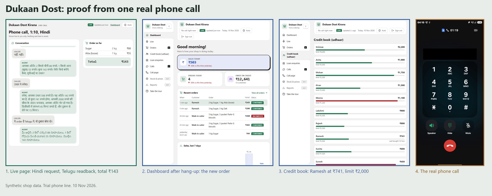
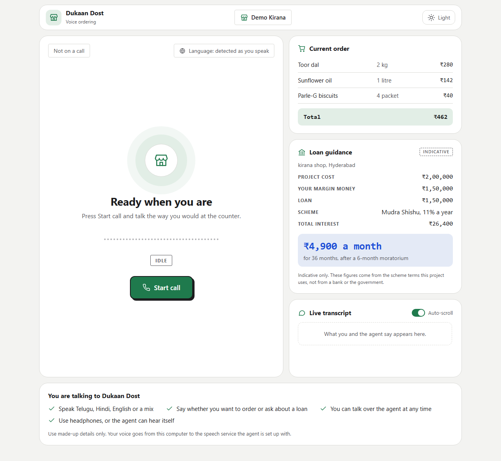
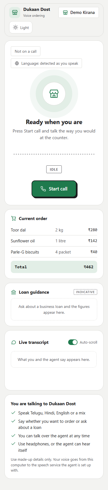
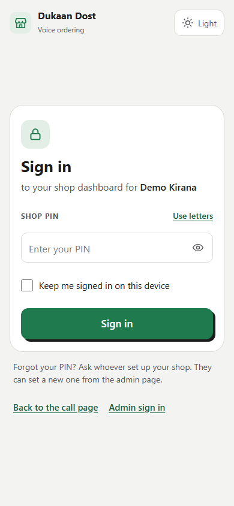
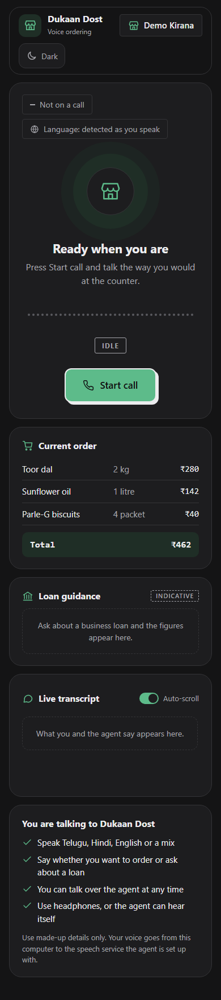
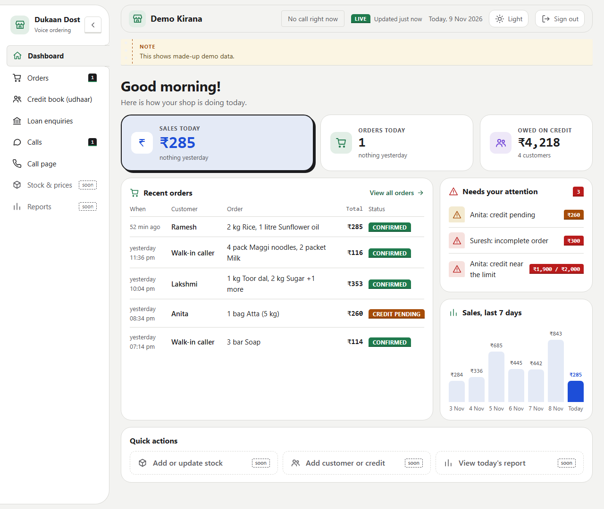
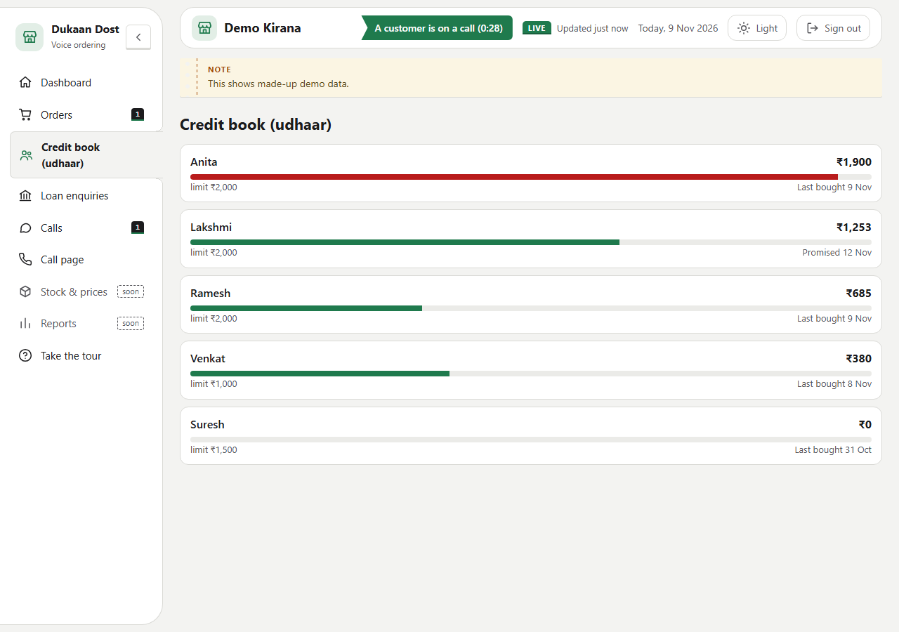
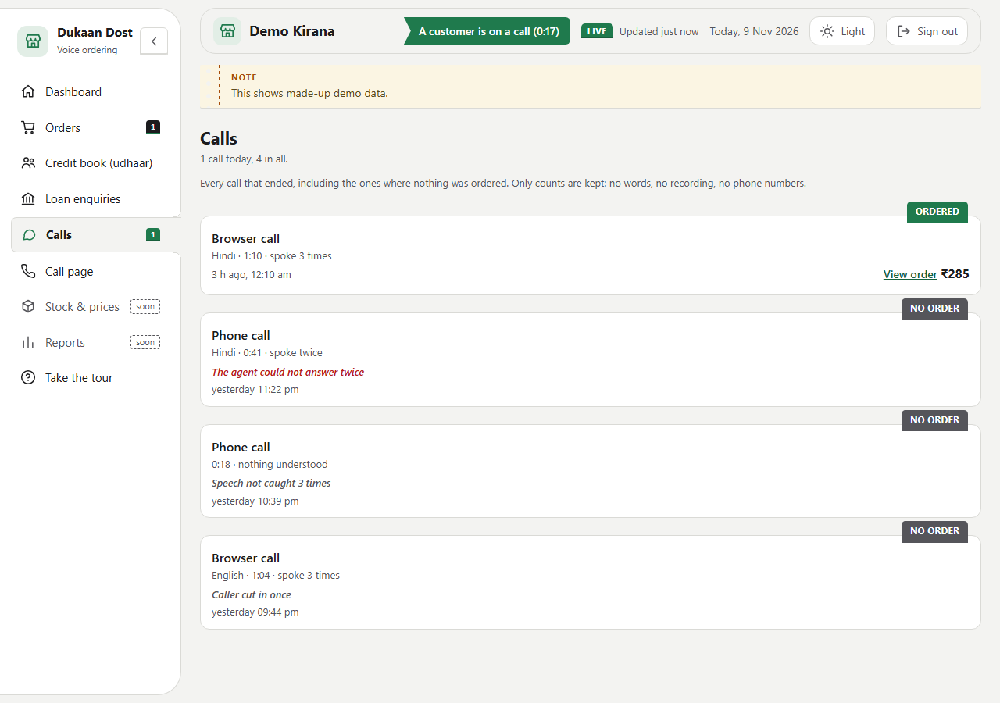
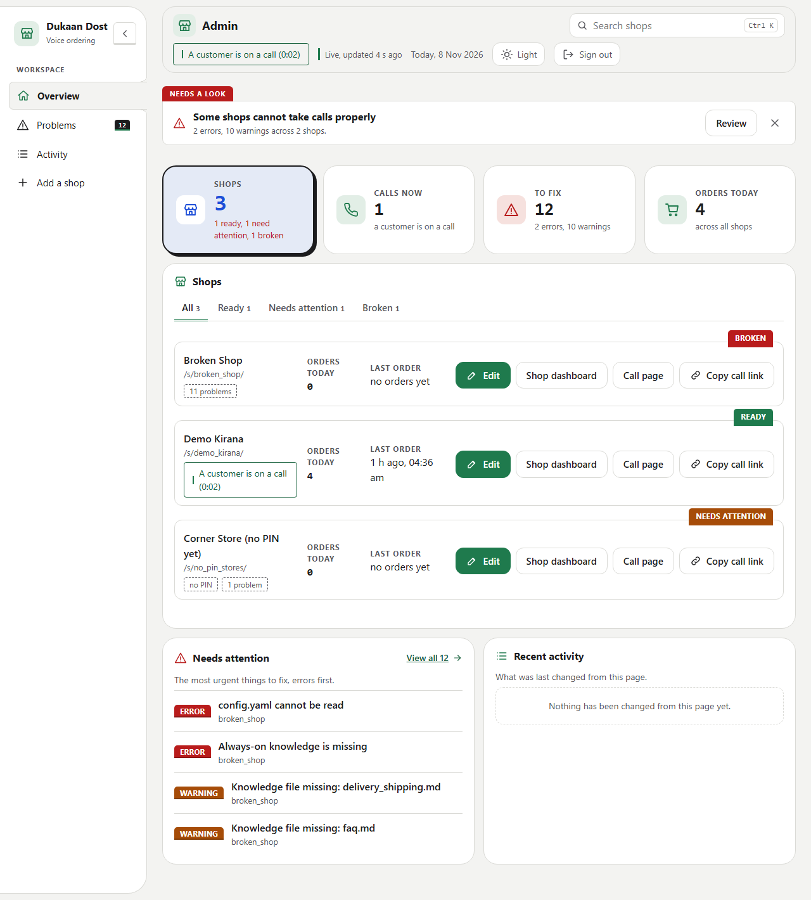

# Dukaan Dost

[](https://github.com/xeyynon/Gnani_Assignment/actions/workflows/ci.yml)

A voice agent for a neighbourhood kirana store. A customer calls and orders in **Telugu, Hindi, English or Hinglish**. The agent matches each item to the shop's stock list, confirms quantities and prices, reads back the total, keeps the shop's **udhaar (credit) book**, gives small-business **loan guidance**, and writes an order summary the shopkeeper sees on a dashboard.

Built for Gnani.ai's **Great Indian AI Internship Challenge**, on Gnani's **Prisma** (speech to text) and **Timbre** (text to speech). Gnani has no public language model, so a separate one reads the order (Groq's gpt-oss by default, Gemini as an option).

It is software only, with no phone hardware. A customer dials an ordinary phone number that a provider (Exotel or Twilio) connects to the agent over a streaming WebSocket, and the agent answers. A browser call page does the same on the same pipeline, so you can try it without a phone. The phone line in the demo is an Exotel trial number behind a temporary tunnel, not a production one.

## Live demo

A real phone call to the agent on an Exotel trial number, with the Live call page and the shopkeeper's dashboard side by side. In the call I order sugar and atta in Hinglish, put it on Ramesh's udhaar, and then ask in Hindi to hear the order again in Telugu.

- [Watch the 60-second demo](demo/dukaan_dost_demo_60s.mp4) (it skips one short turn and a short wait, and both are marked on screen)
- [Watch the full call, no cuts](demo/dukaan_dost_full_take.mp4)



These are real frames from that call. The number on the phone screen is hidden, and the shop, customers and orders are synthetic.

## The idea: the model never does the money
Language models are good at hearing "do kilo cheeni aur ek litre tel" and bad at arithmetic they must get exactly right. So the split is strict:

- the **model** only says which items and how many (one JSON note per turn),
- plain **code** checks every item against the stock list, rounds each line half-up, adds the total, decides credit limits, and **writes every sentence that states an amount**, in the caller's language, from templates.

What the customer hears is therefore exactly what the dashboard shows, and a model slip can add or drop an item but cannot invent a price or a total.

## How a call works
```
Caller audio (a phone call through Exotel or Twilio, or the browser microphone; 16 kHz after the transport)
   ──WebSocket──▶ voice-activity detection (webrtcvad)
   ▶ Gnani Prisma v3.0, streaming speech to text (language detected per call)
   ▶ language model: one JSON order note (items, quantities, payment, name)
   ▶ order code: stock check, rounding, totals, credit limit, spoken sentences (en / hi / te)
   ▶ Gnani Timbre v3.0, streaming text to speech ──▶ back to the caller
   at hang-up ▶ orders/<shop>/order_<id>.json (and loan_<id>.json, ledger.json)  ▶ dashboards
```
- **Barge-in:** the caller can interrupt; the agent stops and listens, and remembers only what was actually heard.
- **Udhaar:** the caller says a name; code finds the customer, checks the limit and balance, and approves, refuses, or leaves it to the shopkeeper. The model never decides.
- **Loan guidance:** a keyword check starts loan mode; the model only reads the amount and whether it is the caller's own money or the project cost; code computes the scheme, the loan and the instalment and speaks them, marked as indicative.
- **Another language on request:** a caller can ask for the order again in a different language, for example in Hindi: "mera order Telugu mein dobara bolo". Code reads the order back in the language asked, with the same total. The language name is recognised in Latin letters, Devanagari or Telugu script.
- **Live call page:** the shopkeeper can watch a call as it happens at `/s/<shop>/live`: the conversation, the order with its running total, the language and the length. A phone has no page of its own, so this is how a phone call is watched.
- **Many shops, one agent:** the browser call link `/s/<shop>/`, or `shop=<shop>` in the phone provider's address, picks the shop; each shop has a PIN-protected dashboard at `/s/<shop>/dashboard` (orders, credit balances, loan enquiries), and one admin page looks after every shop.

How Gnani's models are used:
- **Prisma v3.0:** streaming WebSocket, the shop's product names sent as boost terms, a commit after the caller stops. The first turn of a call lets Prisma choose the language (`indic-auto`); from the second turn of a Telugu call the language is named (Hindi calls stay automatic: a wrong first guess would be kept for the whole call), and a turn that comes back empty is heard again with the language named, because Prisma's own choice is unreliable on short answers (measured below).
- **Timbre v3.0:** streaming WebSocket, 16 kHz audio, one voice for all four languages; a spare connection is opened ahead of time to save about 0.3 s per sentence.

The full architecture is in [MD/architecture.md](MD/architecture.md).

## What it looks like
These are real screenshots of the pages, taken by `scripts/ui_check/snapshots.mjs` against the preview shop. **Every name, amount and order in them is made up** (the preview's demo data), and the figures in them are not results. The full set (every page and state, light and dark, at phone, tablet and desktop widths) is in [snapshots/latest/INDEX.md](snapshots/latest/INDEX.md); how the pages changed build by build is in [snapshots/CHANGES.md](snapshots/CHANGES.md).

**The browser call page** is what someone trying the demo without a phone opens at the shop's link `/s/<shop>/`. Press Start call and talk; the order and the transcript fill in beside the call card. The order panel shows each line and the total, and the loan panel shows a quote when the caller asks about a loan. Here it is before a call, with its panels filled with made-up data.



<table>
<tr>
<td width="33%" valign="top"><b>Call page on a phone</b><br></td>
<td width="33%" valign="top"><b>Shopkeeper sign-in</b><br>A PIN per shop, with a limit on wrong guesses.<br></td>
<td width="33%" valign="top"><b>Dark theme</b><br>Every page has a light and a dark theme.<br></td>
</tr>
</table>

**The Live call page** (`/s/<shop>/live`, behind the same PIN) puts the call in progress on a page of its own, in large type: the conversation with the caller on one side and the agent on the other, the order with its running total, the language and how long the call has lasted. It shows one call at a time, and tabs appear if several calls are listed. Nothing on it is saved. There is no screenshot of it in the set above; the demo video and the proof image show it on a real call.

**The shopkeeper dashboard** (`/s/<shop>/dashboard`, behind the shop's PIN) shows today's sales and orders, what is owed on credit, recent orders with their status, the things that need the shopkeeper's attention (a credit request to confirm, an incomplete order, a customer near their limit) and the last seven days of sales. While someone is on a call, a green strip says so and for how long.



**The credit book (udhaar)** lists each regular customer with what they owe against their limit. The bar turns red near the limit.



**Calls** lists every call that ended, including the ones where nothing was ordered, with a plain reason (speech not caught, the caller cut in, the agent could not answer). Only counts are kept: no words, no recording, no phone numbers.



**The admin page** (`/admin`, behind the admin password) looks after every shop: which are ready, which need attention and which are broken, what to fix first, and adding or editing a shop without touching files.



## How everything works
### One call, start to finish
Take a caller who says, in Hinglish, "do kilo toor dal, ek litre sunflower oil aur char Parle-G, bas" ("two kilos of toor dal, one litre of sunflower oil and four Parle-G, that is all"):

1. **The call opens.** On a phone call, the provider connects to the agent's public address and opens a WebSocket to it. On the browser call page, the page asks for the microphone and opens the WebSocket itself. The agent starts a new call, and every item it queues from then on carries that call's number, so nothing from an earlier call can be spoken into this one.
2. **The agent hears the caller.** The caller's audio arrives as 16-bit PCM from Exotel (at the rate set in the provider's applet, 16 kHz in the demo), as 8 kHz mu-law from Twilio, or as 16 kHz audio from the browser. The transport resamples it to 16 kHz, and it goes through voice-activity detection (`webrtcvad`), which decides when the caller starts and stops talking. While they talk it is streamed to **Gnani Prisma**, which sends back text.
3. **The model reads the order.** The text goes to the language model with the shop's instructions and only the part of the shop's knowledge that matches the sentence. The model must answer with one small JSON note: which items, how many, whether the caller said "that is all", the payment word, a name, and a short reply.
4. **Code does everything about money.** `order_session.py` checks each item against the shop's `stock.json` (an unknown or out-of-stock item is refused), keeps the order, rounds each line half-up and adds the total. The sentences that state an amount, such as the line added and the running total, are written by code from templates in the caller's language and put into the model's reply where it left a placeholder. The model never writes an amount.
5. **A last check, then speech.** `validator.py` swaps in a safe fallback if the reply is empty or has drifted off the shop. The sentences go to **Gnani Timbre**, which streams audio back, and the transport sends it to the caller: down the phone line through the provider, or into the call page.
6. **The caller can interrupt.** If they talk over the agent, playback stops and the agent listens. `spoken_history.py` records which sentences were actually played, so after an interruption the conversation holds only what the caller heard, and the cart is not changed by words they never heard.
7. **Payment.** On "that is all" the agent reads the whole order back with the total and asks how the caller will pay: cash, UPI or credit (udhaar). If the answer is not heard it asks again by name. A caller can also ask for the order again in another language, and the agent reads it back in that language.
8. **After hang-up** the order is written as a small file, together with a count-only record of the call. The shopkeeper's dashboard reads those files.

### The pieces
| Piece | File | What it does |
|---|---|---|
| Main process | `dukaan_dost/app.py` | Five threads (recorder, processor, playback, a watchdog and a metrics writer) that talk only through queues and events |
| Audio transport | `transport_websocket.py`, `transport_telephony.py`, `transport_replay.py` | Where a call's audio comes from: a browser page, a phone provider's stream (Twilio or Exotel), or a script for the evaluation. The rest of the pipeline is the same for all three. Chosen by `AUDIO_TRANSPORT` |
| Speech to text | `stt_gnani.py` (through `stt_provider.py`) | Gnani Prisma over a streaming WebSocket, with the shop's product names as boost terms |
| Language model | `llm_groq.py`, `llm_gemini.py` (through `llm_provider.py`) | Reads the order into JSON. Groq's gpt-oss by default, Gemini optional. Gnani's own reasoning model is not used |
| Knowledge | `knowledge_retriever.py`, `product_search.py` | An always-on core plus the best-matching sections of the shop's files; for a long stock list, only the best few matching items are sent to the model |
| Order | `order_turn.py`, `order_session.py`, `stock.py` | The model's JSON note, the cart, the stock check, every amount and every sentence that states one |
| Credit | `credit.py` | The udhaar book: finds the customer from the name heard, checks the limit and balance, approves, refuses or leaves it to the shopkeeper |
| Loan guidance | `loan_turn.py`, `loan_session.py`, `loan_calculator.py` | A keyword check starts loan mode; the model only reads the amount and whether it is the caller's own money or the project cost; code works out the scheme, the loan and the instalment |
| Text to speech | `tts_gnani.py` (through `tts_provider.py`) | Gnani Timbre over a streaming WebSocket, 16 kHz, one voice for all four languages |
| Interruptions | `spoken_history.py` | Keeps the history to what was really played |
| Saved files | `store.py` | The one place that writes and reads the order, loan, call and ledger files |
| Dashboards | `dashboard.py`, `admin.py`, `auth.py`, `shop_health.py`, `live_feed.py`, `web/` | The shop dashboard, the Live call page (`web/live.html`, fed by `live_feed.py`, which keeps the call in progress in memory), the admin page, the sign-in, and the checks that say what is wrong with a shop |

### The shop folder
Each shop is one folder under `shops/<shop>/`, and the call link `/s/<shop>/` picks it:
- `config.yaml`: the shop's name and its **system prompt**, the instructions the model follows (how to speak, how to take an order, what never to invent).
- `stock.json`: every item with its price and unit and its English, Hindi and Telugu names. This is the only source of prices.
- `customers.json`: the regular customers, each with a credit limit and an opening balance.
- `knowledge/`: Markdown files on delivery, payment, refunds, packaging and recommendations. The always-on core is loaded into every reply; the other files are searched by keyword for the part that matches what the caller said.

Adding a shop is adding a folder, or using the admin page. `shop_health.py` checks the folder (config readable, prompt present, knowledge in place, stock list present, a PIN set) and the admin page shows what is wrong.

### Credit (udhaar) and loans
- **Credit.** The caller says a name. `credit.py` matches it to a customer by letter overlap, so a slightly misheard name still finds the right person, and compares the order total plus the balance with the limit. The outcome is approved, refused, or left for the shopkeeper to confirm. The model passes on the name it heard and nothing else.
- **Loan guidance.** A keyword check in code starts loan mode, with no model call. The model reads the amount in rupees, whether it is the caller's own margin money or the whole project cost, and the business and place. `loan_calculator.py` then works out the project cost, the scheme, the loan, the interest and the monthly instalment, and the agent speaks them marked as indicative. The scheme figures come from the challenge's problem statement and are not a bank's or the government's current terms.

### What is saved, and what is not
- `orders/<shop>/order_<call_id>.json`: one order per call, with every line, the total, the payment and a status (confirmed, credit pending or incomplete).
- `orders/<shop>/loan_<call_id>.json`: one loan enquiry per loan call.
- `orders/<shop>/ledger.json`: the credit book.
- A **count-only call record** (`call_stats.py`): how many times the caller spoke, whether they cut in, how many times speech was not caught. No words, no audio, no phone number.
- **Nothing else is kept.** The live transcript the shopkeeper's dashboard shows during a call (`live_feed.py`) lives in memory for the length of the call, is never written to disk and reaches only the signed-in shop pages (the dashboard and the Live call page), not the public call page. Call recording is off.

The `orders/` folder is gitignored (only `orders/samples/` is committed), so data from a run never reaches the repository.

### Sign-in
There are no accounts and no database. Each shop has a **PIN**, stored hashed with a random salt in `data/auth.json` (gitignored), and a shop with no PIN cannot be signed in to: there is no default. The admin page uses one password from the `ADMIN_PASSWORD` setting. Five wrong guesses from one address lock that shop's sign-in for a while.

### The phone line and the evaluation use the same pipeline
The phone line is the main way to use Dukaan Dost. `AUDIO_TRANSPORT` changes only where the audio comes from. With `telephony`, an Exotel or Twilio media stream connects to the agent through a public address. With `replay`, a script plays prepared synthetic speech into the real pipeline at real-time pace, with silence or steady noise in between, and the scorer compares the saved order with the expected one. That is how the figures under [Results](#results) were produced.

To take a real call (the full steps are in [MD/phone_setup.md](MD/phone_setup.md)):
```bash
python scripts/phone_demo.py
# starts the agent in phone mode and a public tunnel, and prints the tunnel address.
# In the Exotel Voicebot applet, set the address to:
#   wss://<tunnel host>/telephony/exotel?sample-rate=16000&shop=<shop>&token=<TELEPHONY_TOKEN>
```
`TELEPHONY_TOKEN` is a long random secret of at least 16 characters that you keep in `.env`. It is never written in the repository, and with no token every phone call is refused. The tunnel address changes each time it restarts, so the applet address has to be updated each time. The agent takes one call at a time.

### Try the pages without any keys
```bash
python -m dukaan_dost.preview      # a made-up shop, made-up orders, no speech and no model
```
It starts only the web server with three made-up shops (one ready, one with no PIN, one broken), prints the sign-in details, and opens the dashboard. Talking to the agent needs the real run (`python -m dukaan_dost`, with the keys from [SETUP.md](SETUP.md)). To retake the screenshots above, run the preview and point `scripts/ui_check/snapshots.mjs` at it (the command is in that file's header).

## Results
<!-- RESULTS:BEGIN -->
Every figure below comes from a saved run in [evaluation/results/](evaluation/results/). Voices are synthetic Timbre voices, not people.

**Prisma on its own, no language model** ([stt_accuracy_prisma](evaluation/results/stt_accuracy_prisma.md), 2026-11-07): the 65 turns of the order script, each sent four ways. "Exactly right" means word for word against the script (number words turned into digits). The phone line is my own simulation (8 kHz, 300 to 3,400 Hz, mu-law), not a real operator's audio.

| Way of sending | Turns exactly right (of 65) | Turns heard as nothing |
|---|---|---|
| Clean audio, Prisma chooses the language | 25 | 3 |
| Clean audio, language named | 31 | 0 |
| Simulated phone line, Prisma chooses | 16 | 10 |
| Simulated phone line, language named | 19 | 3 |

Short turns (up to 1.6 s: "cash", "that's all", a name) were exactly right on 14 of 31 with Prisma choosing and 19 of 31 with the language named; Telugu calls, on clean audio, on 5 of 16 and 10 of 16. This is why the agent now names the language.

**Scripted credit and loan calls, the whole pipeline** ([credit_loans_clean_120b](evaluation/results/credit_loans_clean_120b.md), 2026-11-09, gpt-oss-120b, with the loose-atta stock, Builds 1016 and 1019 and the first two changes of Build 1023): 4 of 4 order calls and 4 of 4 loan calls exactly right, every turn answered (18 of 18), first audio 2.2 s at the median and 2.5 s at the 90th percentile after the caller's last word. Only 8 calls, so the 95% interval is wide (51% to 100%). The same calls one change earlier (Hindi also named to Prisma) lost one Telugu loan call (3 of 4 loans; [credit_loans_hindi_named_120b](evaluation/results/credit_loans_hindi_named_120b.md), kept as evidence): the first turn of that call was heard as Hindi, and naming Hindi decoded the rest wrongly.

**Whole pipeline, the 20-call order script** ([orders_clean_search_20b](evaluation/results/orders_clean_search_20b.md), 2026-11-09, gpt-oss-20b in search mode, the committed code of Build 1019, 20 scripted calls and 65 turns, no refused request): **18 of 20 orders exactly right** (items and quantities; 95% interval 70% to 97%), item recall and precision 1.00 each, every spoken total equal to the stock-list arithmetic (20 of 20), first audio 2.2 s at the median and 2.7 s at the 90th percentile after the caller's last word. The 2 wrong orders were both hearing errors: "ek litre" written as "8 litre" and the Telugu word for "half" dropped. The payment word was recorded on 16 of 20 calls: in the other 4 the last one-word answer ("cash") was not heard, the agent asked to repeat, and the scripted caller had nothing more to say (a real caller would repeat it; since Build 1021 the agent asks "How would you like to pay: cash, UPI or credit?" in that case, which the scripted run did not measure); and 1 of 65 turns got no reply. Language by language: English 4 of 4, Hinglish 8 of 8, Hindi 2 of 3, Telugu 4 of 5. A different mode (whole catalogue instead of search) and gpt-oss-120b were not scored validly: see below.

**Not scored validly:** two earlier full runs (gpt-oss-20b whole catalogue, and gpt-oss-120b search mode) were marked INVALID because the model's daily token limit ran out near their end, so no figure from them is quoted; they are kept as evidence in `evaluation/results/INVALID_*`.

**Seen, not scored:** on 2026-11-07 two real phone calls to an Exotel trial number connected to the agent and were heard; one saved an order (1 litre of oil, cash, confirmed). On 2026-11-10 more real calls were made to the same number, and one of them is the demo video: 2 kg of sugar and 1 kg of atta (143 rupees), put on Ramesh's udhaar (balance 598 rupees, 741 after the order, within the 2,000 rupee limit), then a Hindi request, "mera order Telugu mein dobara bolo", and the agent read the order back in Telugu. That call was seen and heard, and it is not part of any score.
<!-- RESULTS:END -->

How it is measured: scripted calls, with synthetic Timbre voices, are played into the **real** agent (voice detection, Prisma, the language model, the order code, Timbre) by a replay transport, with no browser. The scorer compares the saved order with the expected one (items and quantities exactly), and reports word error rate, time to first audio and cut-off counts. Steady synthetic noise can be mixed in at a chosen level. The method, the scripts and the scorer are in [evaluation/](evaluation/README.md).

## Honest limits
- All voices, shops, customers and orders are **synthetic**. No real caller has used it.
- The browser call page has been exercised by automated browser tests, not yet by a person with a microphone on a long call. The phone line has been used for real calls by one person only, who was also the developer: two calls on 2026-11-07 and more on 2026-11-10, including the one in the demo video.
- Switching language inside one call (a Hinglish order, a Hindi request, then a Telugu readback) worked on the demo call, but the scored runs use one language per call, so it is lightly tested.
- One call at a time; a second caller hears "busy". The design for several callers is in [MD/architecture.md](MD/architecture.md).
- The phone line runs on an Exotel trial number through a temporary tunnel, with no KYC-approved production number; the phone-line figures above use a simulated line, not real operator audio.
- Prisma still mishears short answers and numbers ("ek litre" was written as "8 litre" even on clean audio); the code asks again or moves the order on, but the first hearing can be wrong.
- The one valid whole-script score is 20 synthetic calls at one sitting on one model in one mode; 18 of 20 has a wide interval (70% to 97%), and the script's voices are clean synthetic ones.
- The Hindi and Telugu product names and sentences were written by the assistant and need a native speaker's check.
- The loan scheme figures come from the challenge's problem statement and are indicative; they are not any bank's or government's current terms.
- The language model runs on a free tier with a daily token limit, which caps how often the evaluation can be repeated.

## Getting started
Setup, keys and run commands are in **[SETUP.md](SETUP.md)**. In short:
```bash
pip install -r requirements.txt
cp .env.example .env            # add GNANI_API_KEY and GROQ_API_KEY
python -m dukaan_dost           # then open the printed address and press Start call (browser)
python scripts/phone_demo.py    # or take real phone calls: the agent plus a tunnel (see MD/phone_setup.md)
python -m pytest                # offline tests
```

## Repository layout
```
dukaan_dost/   the agent: run with `python -m dukaan_dost`
shops/         one folder per shop (config.yaml, stock.json, customers.json, knowledge/), see shops/README.md
evaluation/    scripted calls, the runner and scorer; committed results
tests/         offline tests (tests/manual needs cloud credentials)
scripts/       changelog.mjs (builds and InBuls), the checks CI runs, a local CI copy
.github/       GitHub Actions: CI on every push, a release and image per build tag
MD/            architecture, flow, product and phone-line notes, and the build reports
```

## Documentation
The architecture, call flow, product notes and phone-line set-up are in [MD/](MD/); what has shipped is in [CHANGELOG.md](CHANGELOG.md).

## Data
**All data in this project is synthetic.** The stock list, prices, customers, shop details, UPI ID, order scripts and test audio are made up. No real customer phone numbers or IDs are used, and call recording in the agent is turned off. The demo video is a screen and microphone recording of one call the developer made, with the phone number hidden.
