# What changed in the UI, release by release

Each release's pages as they really looked then, taken from git by `scripts/ui_check/snapshot_release.py` (that release's own code and its own made-up data). Under each release the previous picture sits beside this one, in light and dark, on a phone and on a desktop, so a change can be seen without opening anything. Click a picture for the full-size page. The full set of every page and state today is in [latest/INDEX.md](latest/INDEX.md).

Releases with no screen change (a build that only changed the agent, the evaluation or the docs) are not listed; the build reports in `MD/builds/` cover them.

## Timeline

| # | Release | Date | What changed on screen |
|---|---|---|---|
| 01 | [build 1002](#01-build-1002) | 2026-10-28 | One white card on a pale page with the name, one sentence, a thin progress bar, Start call and Hang up buttons, an 'agent silent' tag and three tips. |
| 02 | [build 1003](#02-build-1003) | 2026-10-28 | A new dashboard page: a made-up-data notice, four figures (orders today, sales today, owed on credit, needs you), then Orders on the left and the Credit book with limit bars and Loan enquiries on the right. |
| 03 | [build 1004](#03-build-1004) | 2026-11-02 | A green strip, 'A customer is on a call' with how long it has lasted, appears under the notice while someone is calling. |
| 04 | [build 1005](#04-build-1005) | 2026-11-02 | The call page becomes a call screen (ring, status chips, timer, waveform dots, live transcript, order panel) and the dashboard gets a side menu, icon tiles with change since yesterday, a 7-day sales chart and a needs-attention list. |
| 05 | [build 1006](#05-build-1006) | 2026-11-02 | Both pages move to white cards on a pale slate page: green for the brand, blue for sales, violet for credit, amber for pending, red for errors. |
| 06 | [build 1007](#06-build-1007) | 2026-11-02 | A new look: a bento grid with one big hero Sales tile, glass menu and bars over soft colour glows, hard-edged accents on the main button and figure, a drawer menu that can be hidden, and a Light / Dark / Auto switch. |
| 07 | [build 1009](#07-build-1009) | 2026-11-03 | A new /admin page in the same look: four tiles (shops, calls now, to fix, orders today) and a list of every shop with its state and Edit, Shop dashboard and Call page buttons. |
| 08 | [build 1010](#08-build-1010) | 2026-11-03 | The admin page starts dark with near-black surfaces and a lime accent, and gets a search box, filter tabs with counts, a dismissable notice, overview panels, an Activity view and a Copy call link button. |
| 09 | [build 1011](#09-build-1011) | 2026-11-03 | A Loan guidance panel appears on the call page. It is empty until a caller asks about a loan, then it shows the project cost, margin money, loan, scheme and rate, total interest and the monthly instalment, marked indicative. |
| 10 | [build 1012](#10-build-1012) | 2026-11-05 | All pages share one flat palette (charcoal in dark, off-white in light, one calm green): the coloured glows, the glass blur and the admin's lime accent are gone. |
| 11 | [build 1015](#11-build-1015) | 2026-11-06 | Opening a dashboard while signed out now shows a proper sign-in card (PIN field with a show button, 'keep me signed in', tries left and a lockout countdown); the dashboard and admin top bars get a Sign out button. |
| 12 | [build 1017](#12-build-1017) | 2026-11-08 | The dashboard's side menu gets a 'Call page' item with a phone icon, between Loan enquiries and Stock & prices; it opens that shop's own call page. |
| 13 | [build 1018](#13-build-1018) | 2026-11-08 | Every page marks things its own way instead of tinted pills, rows and dots: statuses are tabs on a card's edge, the desktop menu's open item is a tab into the page, counts are small tabs, the demo note is a paper slip, and a live call is a notched green tab on the dashboard and an outlined box with a pen caret elsewhere. The dashboard gets a Calls menu item. |
| 14 | [build 1020](#14-build-1020) | 2026-11-09 | The freshness of the data is a small tab with a word in it, a green LIVE or a red OFFLINE, then the time in plain text; the dot, the thin green edge and the blinking caret are gone. Notes on a call card lose their line. An ordered call links to its order. |
| 15 | [build 1022](#15-build-1022) | 2026-11-09 | The shop dashboard gets a menu item, Take the tour, and a four-step tour on a first visit; empty lists carry a title, a sentence on what will appear and a way to start. |
| 16 | [build 1024](#16-build-1024) | 2026-11-09 | Layout changes that only show in a very narrow window (a 390 px phone at 150% or 200% browser zoom): orders stack into one column, tile figures stay whole, panel tags drop under their title. The landing pictures at 390 and 1280 px look the same. |

<a id="01-build-1002"></a>
## 01. The first call page: a browser tab you call from

Release `build-1002`, commit `b1fbbc2`, 2026-10-28. Build report: [`MD/builds/build-1002.md`](../MD/builds/build-1002.md).

**On screen:** One white card on a pale page with the name, one sentence, a thin progress bar, Start call and Hang up buttons, an 'agent silent' tag and three tips.

What is different from the one before:

- This is the first page there is: the project became software-only (no Raspberry Pi) and the call moved to a browser tab.
- Nothing else exists yet: no dashboard, no order panel, no transcript, no dark-mode switch (it follows the device).

_Not looked at: a call in progress (the page needs a live agent behind it)._

| Page | Shown | Light: before | Light: this release | Dark: before | Dark: this release |
|---|---|---|---|---|---|
| Call page | phone 390 px | (first release) | <a href="history/01-build-1002/call-page/01-landing/light-phone-390.png">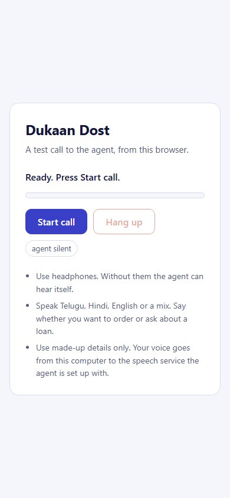</a> | (first release) | <a href="history/01-build-1002/call-page/01-landing/dark-phone-390.png"></a> |
| Call page | desktop 1280 px | (first release) | <a href="history/01-build-1002/call-page/01-landing/light-desktop-1280.png">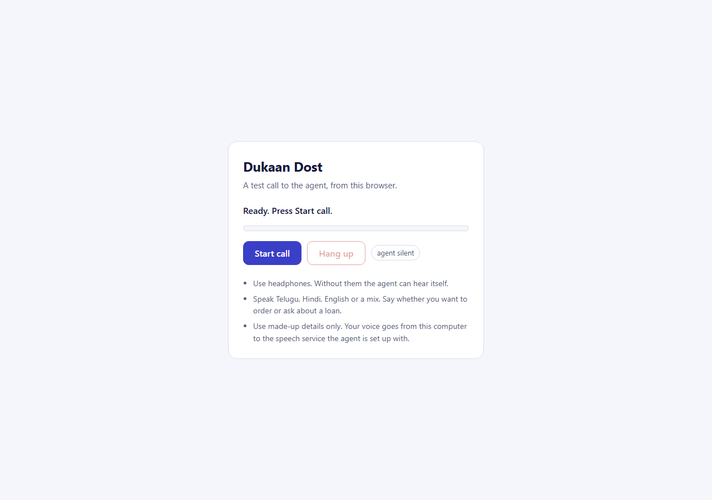</a> | (first release) | <a href="history/01-build-1002/call-page/01-landing/dark-desktop-1280.png"></a> |

<a id="02-build-1003"></a>
## 02. The shopkeeper dashboard appears

Release `build-1003`, commit `4deedcc`, 2026-10-28. Run from `86d706a`, the next commit, which has the same pages and a preview to run.. Build report: [`MD/builds/build-1003.md`](../MD/builds/build-1003.md).

**On screen:** A new dashboard page: a made-up-data notice, four figures (orders today, sales today, owed on credit, needs you), then Orders on the left and the Credit book with limit bars and Loan enquiries on the right.

What is different from the one before:

- New page: the shopkeeper's dashboard, one long page of plain cards with no menu.
- The call page now carries the shop's name (each shop has its own call link).

_Not looked at: the sign-in, which is the browser's own prompt and cannot be photographed._

| Page | Shown | Light: before | Light: this release | Dark: before | Dark: this release |
|---|---|---|---|---|---|
| Call page | phone 390 px | <a href="history/01-build-1002/call-page/01-landing/light-phone-390.png"></a> | <a href="history/02-build-1003/call-page/01-landing/light-phone-390.png"></a> | <a href="history/01-build-1002/call-page/01-landing/dark-phone-390.png"></a> | <a href="history/02-build-1003/call-page/01-landing/dark-phone-390.png"></a> |
| Call page | desktop 1280 px | <a href="history/01-build-1002/call-page/01-landing/light-desktop-1280.png"></a> | <a href="history/02-build-1003/call-page/01-landing/light-desktop-1280.png"></a> | <a href="history/01-build-1002/call-page/01-landing/dark-desktop-1280.png"></a> | <a href="history/02-build-1003/call-page/01-landing/dark-desktop-1280.png"></a> |
| Shop dashboard | phone 390 px | (new page) | <a href="history/02-build-1003/dashboard/01-landing/light-phone-390.png">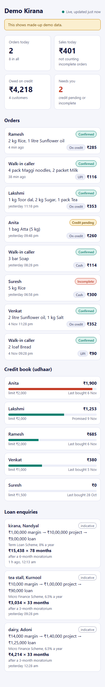</a> | (new page) | <a href="history/02-build-1003/dashboard/01-landing/dark-phone-390.png">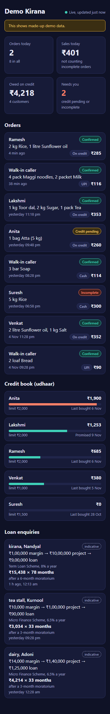</a> |
| Shop dashboard | desktop 1280 px | (new page) | <a href="history/02-build-1003/dashboard/01-landing/light-desktop-1280.png">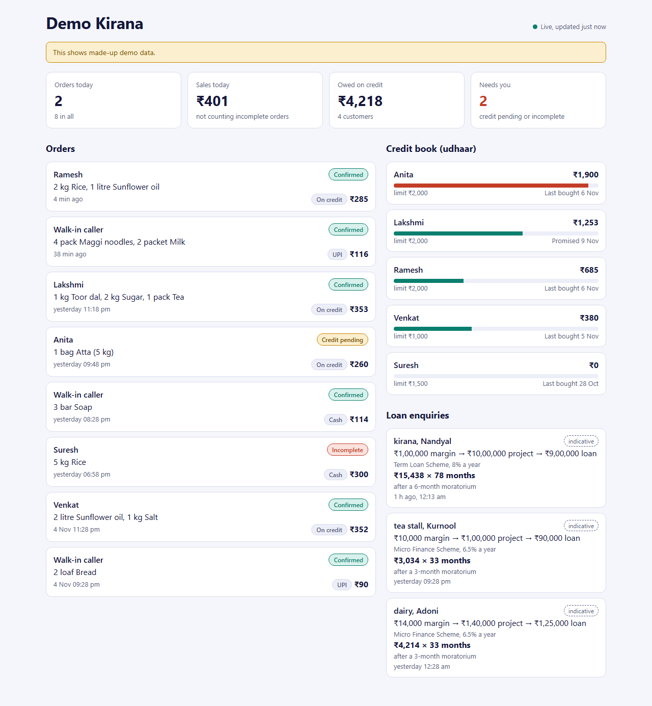</a> | (new page) | <a href="history/02-build-1003/dashboard/01-landing/dark-desktop-1280.png">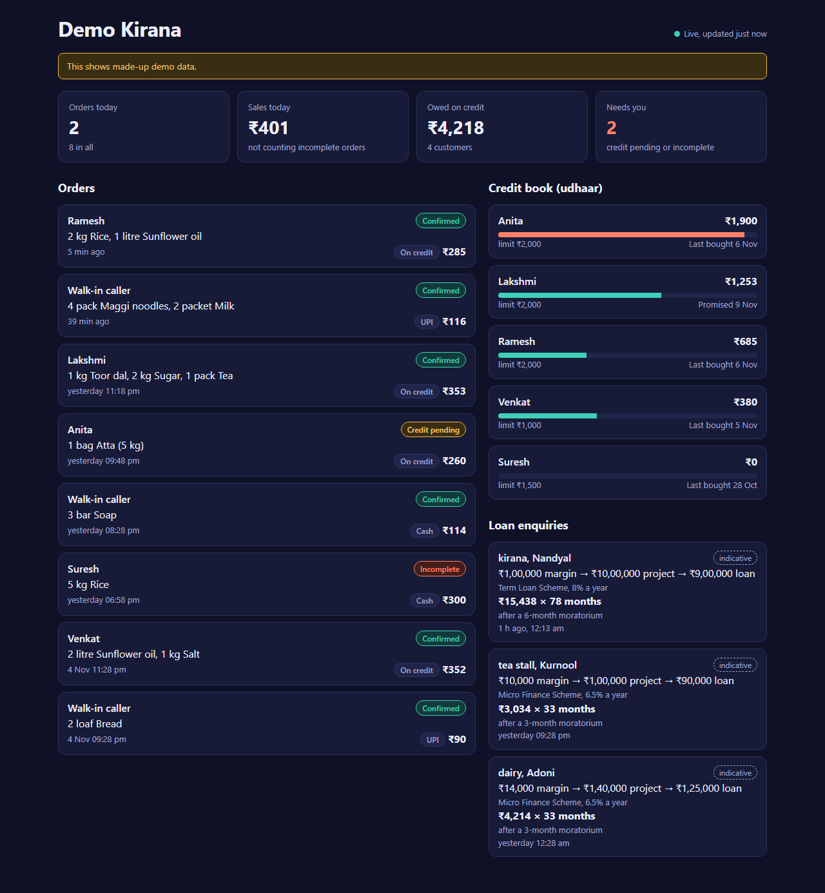</a> |

<a id="03-build-1004"></a>
## 03. The dashboard shows a call in progress

Release `build-1004`, commit `ae14356`, 2026-11-02. Build report: [`MD/builds/build-1004.md`](../MD/builds/build-1004.md).

**On screen:** A green strip, 'A customer is on a call' with how long it has lasted, appears under the notice while someone is calling.

What is different from the one before:

- Dashboard: the green live-call strip. Everything else on both pages looks the same as the release before.

| Page | Shown | Light: before | Light: this release | Dark: before | Dark: this release |
|---|---|---|---|---|---|
| Call page | phone 390 px | <a href="history/02-build-1003/call-page/01-landing/light-phone-390.png"></a> | <a href="history/03-build-1004/call-page/01-landing/light-phone-390.png">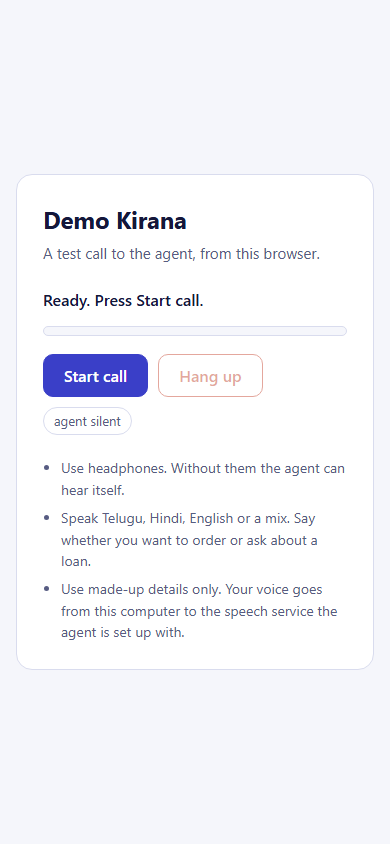</a> | <a href="history/02-build-1003/call-page/01-landing/dark-phone-390.png"></a> | <a href="history/03-build-1004/call-page/01-landing/dark-phone-390.png">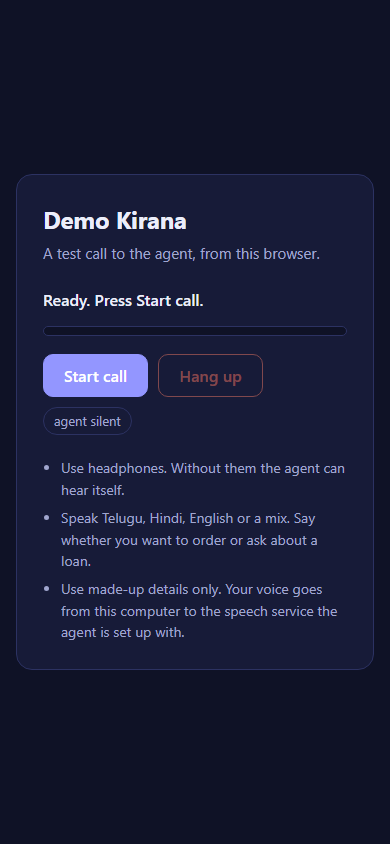</a> |
| Call page | desktop 1280 px | <a href="history/02-build-1003/call-page/01-landing/light-desktop-1280.png"></a> | <a href="history/03-build-1004/call-page/01-landing/light-desktop-1280.png">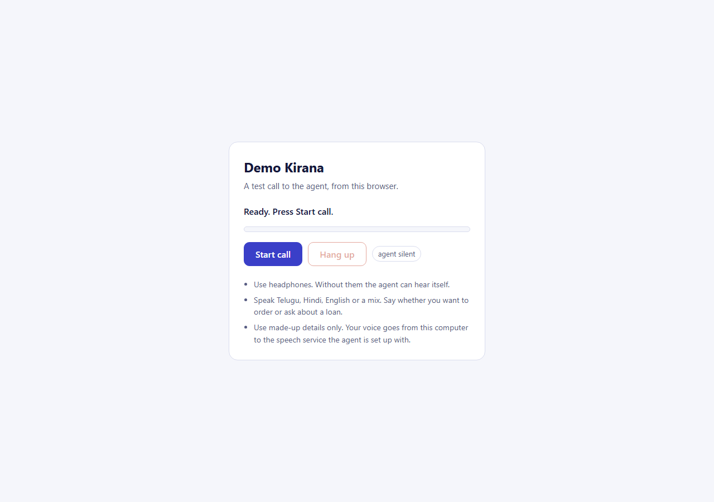</a> | <a href="history/02-build-1003/call-page/01-landing/dark-desktop-1280.png"></a> | <a href="history/03-build-1004/call-page/01-landing/dark-desktop-1280.png">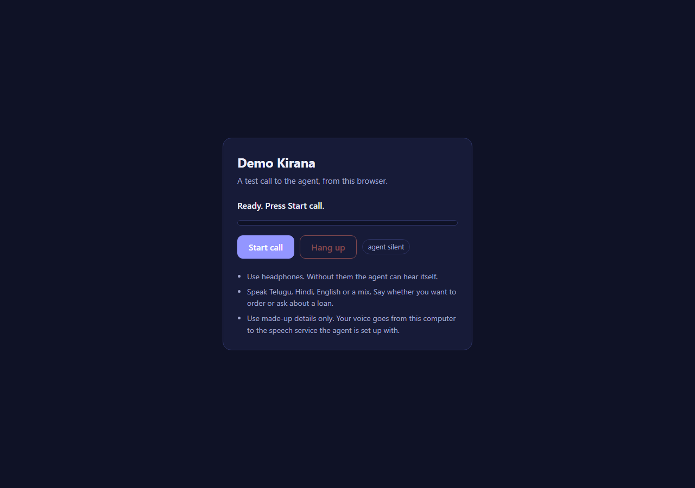</a> |
| Shop dashboard | phone 390 px | <a href="history/02-build-1003/dashboard/01-landing/light-phone-390.png"></a> | <a href="history/03-build-1004/dashboard/01-landing/light-phone-390.png">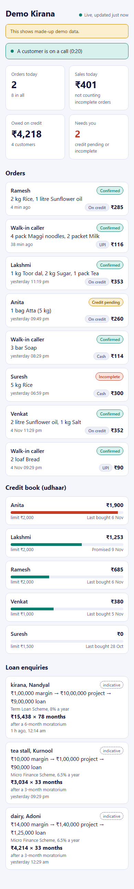</a> | <a href="history/02-build-1003/dashboard/01-landing/dark-phone-390.png"></a> | <a href="history/03-build-1004/dashboard/01-landing/dark-phone-390.png">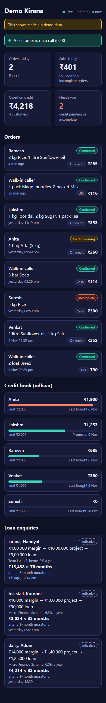</a> |
| Shop dashboard | desktop 1280 px | <a href="history/02-build-1003/dashboard/01-landing/light-desktop-1280.png"></a> | <a href="history/03-build-1004/dashboard/01-landing/light-desktop-1280.png">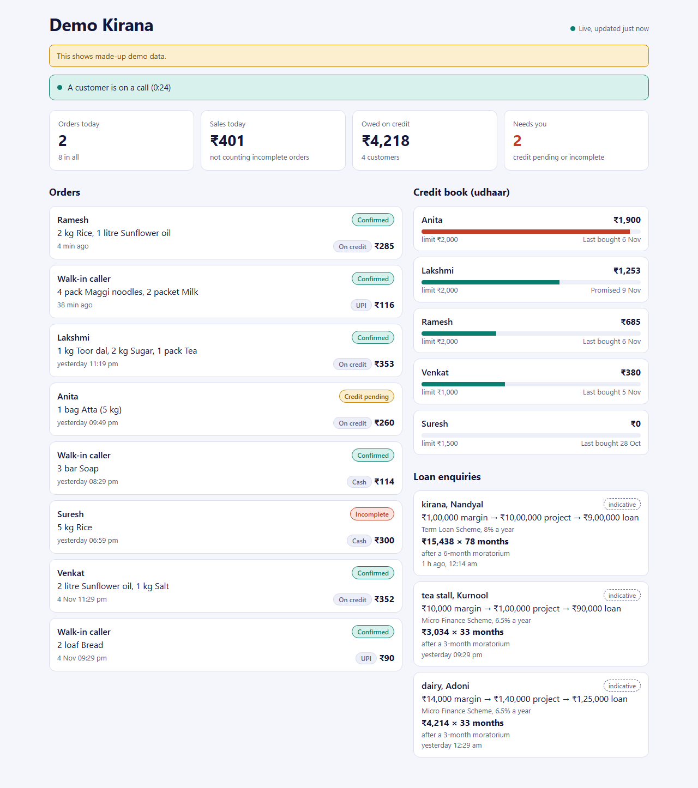</a> | <a href="history/02-build-1003/dashboard/01-landing/dark-desktop-1280.png"></a> | <a href="history/03-build-1004/dashboard/01-landing/dark-desktop-1280.png">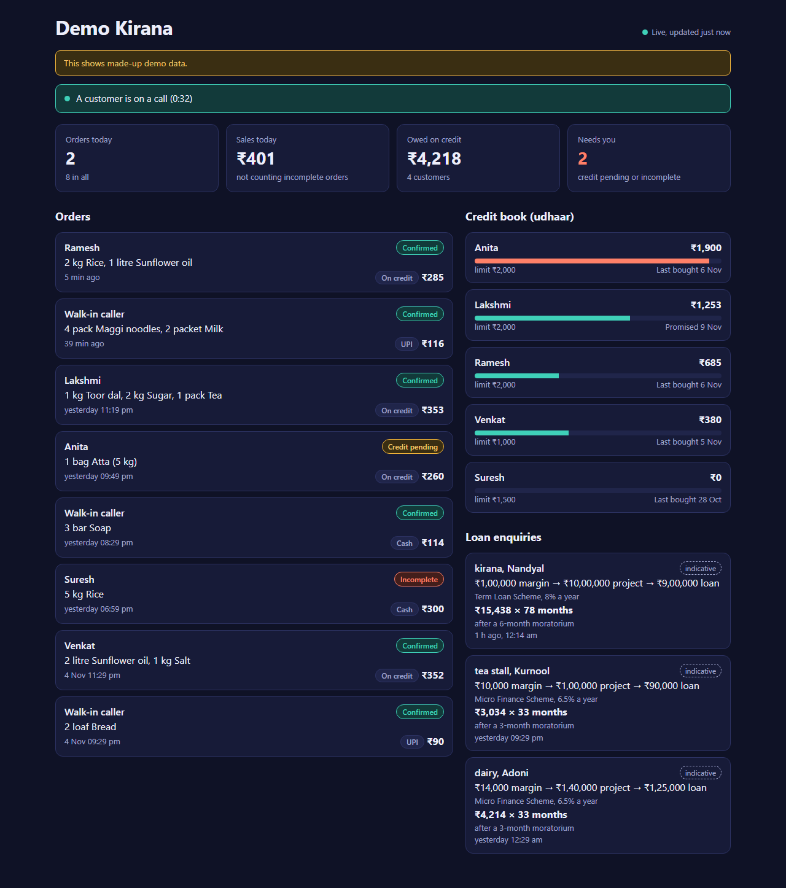</a> |

<a id="04-build-1005"></a>
## 04. A call screen, and a dashboard with a menu

Release `build-1005`, commit `263a32a`, 2026-11-02. Build report: [`MD/builds/build-1005.md`](../MD/builds/build-1005.md).

**On screen:** The call page becomes a call screen (ring, status chips, timer, waveform dots, live transcript, order panel) and the dashboard gets a side menu, icon tiles with change since yesterday, a 7-day sales chart and a needs-attention list.

What is different from the one before:

- Call page: from one card to a two-column screen: the call on the left; Current order, Live transcript and tips on the right.
- Dashboard: a side menu (Dashboard, Orders, Credit book, Loan enquiries, and two 'soon' items), a greeting, tiles with icons and '% vs yesterday', Recent orders as a table, Needs your attention, Quick actions, Sales last 7 days.
- The look is warm cream with muted green.

_Not looked at: the call in progress (waveform, transcript filling) and the dashboard's other views._

| Page | Shown | Light: before | Light: this release | Dark: before | Dark: this release |
|---|---|---|---|---|---|
| Call page | phone 390 px | <a href="history/03-build-1004/call-page/01-landing/light-phone-390.png"></a> | <a href="history/04-build-1005/call-page/01-landing/light-phone-390.png">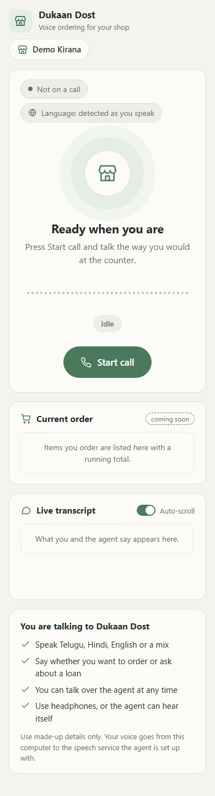</a> | <a href="history/03-build-1004/call-page/01-landing/dark-phone-390.png"></a> | <a href="history/04-build-1005/call-page/01-landing/dark-phone-390.png">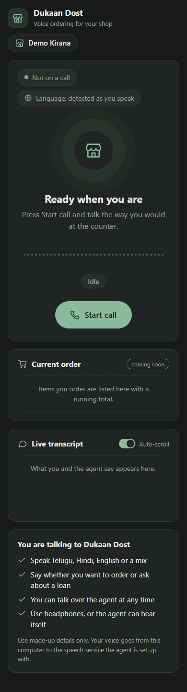</a> |
| Call page | desktop 1280 px | <a href="history/03-build-1004/call-page/01-landing/light-desktop-1280.png"></a> | <a href="history/04-build-1005/call-page/01-landing/light-desktop-1280.png">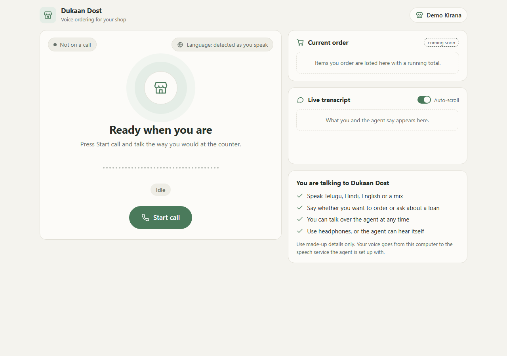</a> | <a href="history/03-build-1004/call-page/01-landing/dark-desktop-1280.png"></a> | <a href="history/04-build-1005/call-page/01-landing/dark-desktop-1280.png">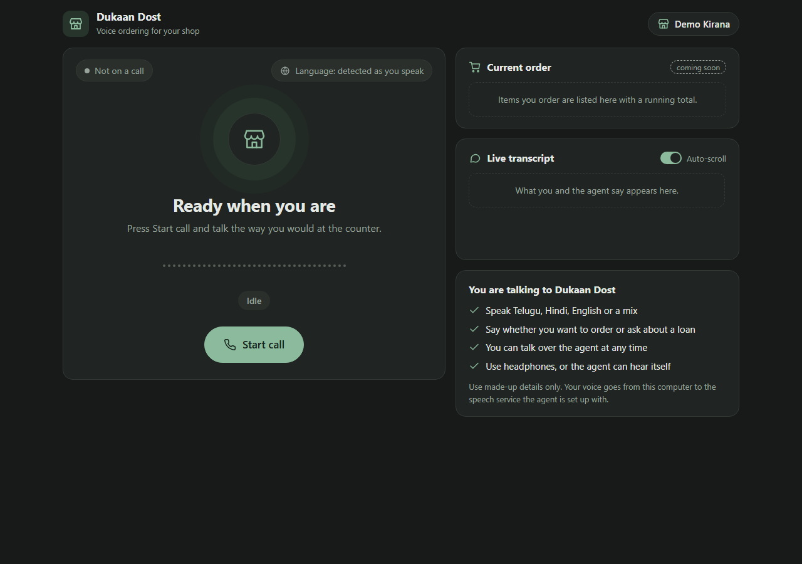</a> |
| Shop dashboard | phone 390 px | <a href="history/03-build-1004/dashboard/01-landing/light-phone-390.png"></a> | <a href="history/04-build-1005/dashboard/01-landing/light-phone-390.png">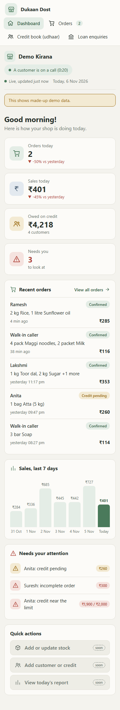</a> | <a href="history/03-build-1004/dashboard/01-landing/dark-phone-390.png"></a> | <a href="history/04-build-1005/dashboard/01-landing/dark-phone-390.png">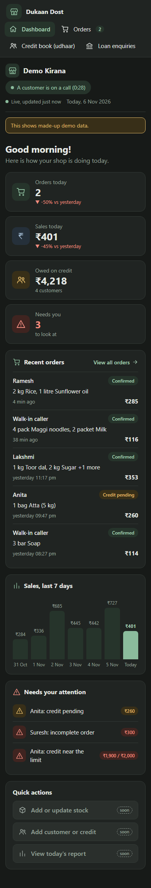</a> |
| Shop dashboard | desktop 1280 px | <a href="history/03-build-1004/dashboard/01-landing/light-desktop-1280.png"></a> | <a href="history/04-build-1005/dashboard/01-landing/light-desktop-1280.png">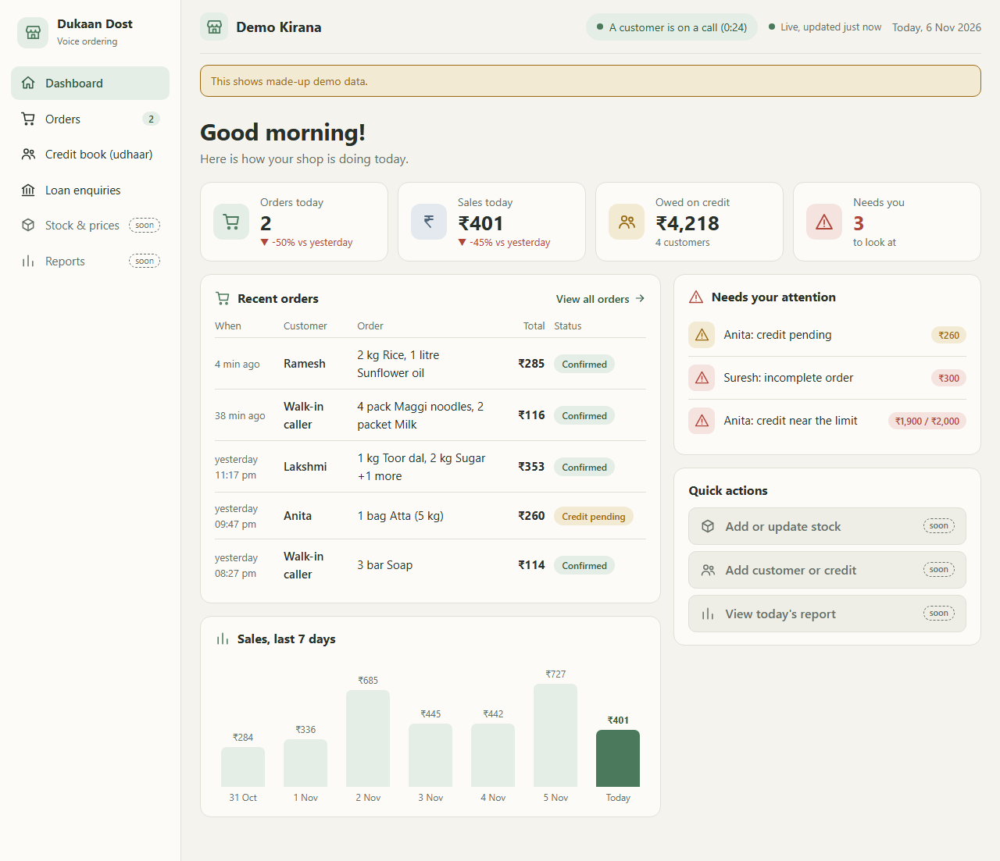</a> | <a href="history/03-build-1004/dashboard/01-landing/dark-desktop-1280.png"></a> | <a href="history/04-build-1005/dashboard/01-landing/dark-desktop-1280.png">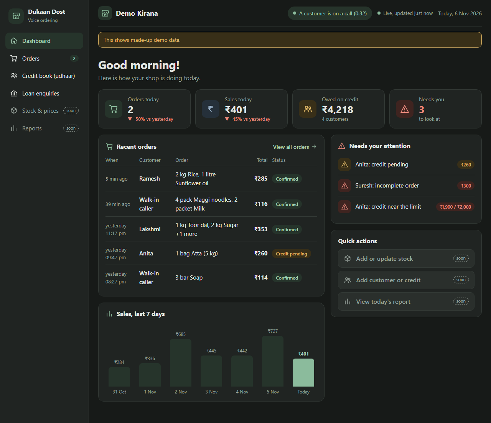</a> |

<a id="05-build-1006"></a>
## 05. One palette for both pages (Kirana Green)

Release `build-1006`, commit `6a712a3`, 2026-11-02. Build report: [`MD/builds/build-1006.md`](../MD/builds/build-1006.md).

**On screen:** Both pages move to white cards on a pale slate page: green for the brand, blue for sales, violet for credit, amber for pending, red for errors.

What is different from the one before:

- Colour only: the layout is the same as the release before.
- Dashboard: icon tiles are green, blue, violet and red; the sales bars are blue instead of green.

| Page | Shown | Light: before | Light: this release | Dark: before | Dark: this release |
|---|---|---|---|---|---|
| Call page | phone 390 px | <a href="history/04-build-1005/call-page/01-landing/light-phone-390.png"></a> | <a href="history/05-build-1006/call-page/01-landing/light-phone-390.png">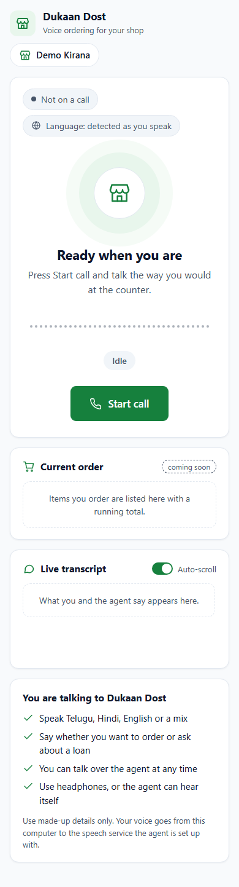</a> | <a href="history/04-build-1005/call-page/01-landing/dark-phone-390.png"></a> | <a href="history/05-build-1006/call-page/01-landing/dark-phone-390.png">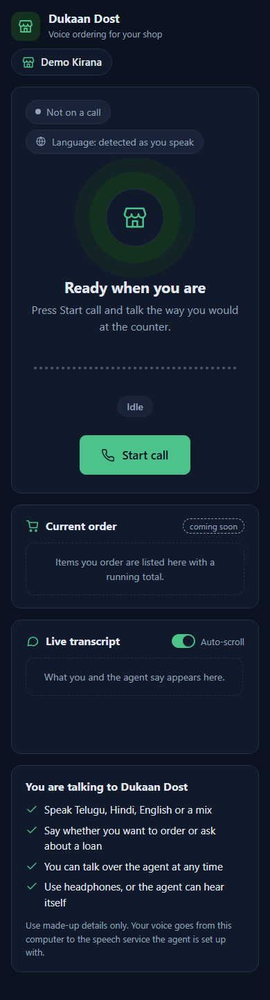</a> |
| Call page | desktop 1280 px | <a href="history/04-build-1005/call-page/01-landing/light-desktop-1280.png"></a> | <a href="history/05-build-1006/call-page/01-landing/light-desktop-1280.png">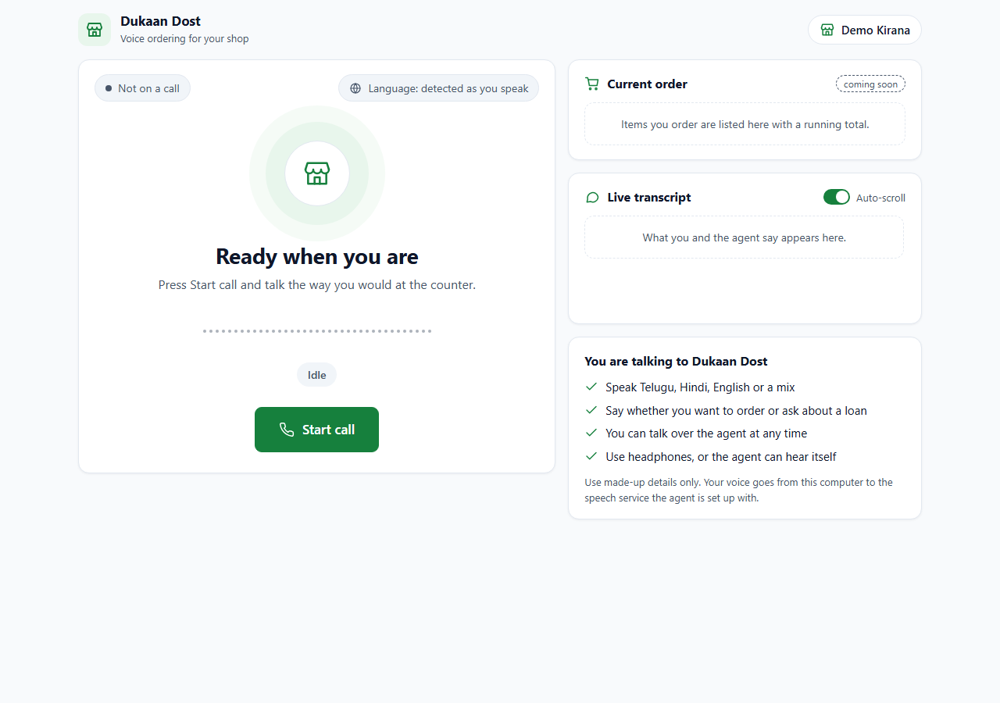</a> | <a href="history/04-build-1005/call-page/01-landing/dark-desktop-1280.png"></a> | <a href="history/05-build-1006/call-page/01-landing/dark-desktop-1280.png">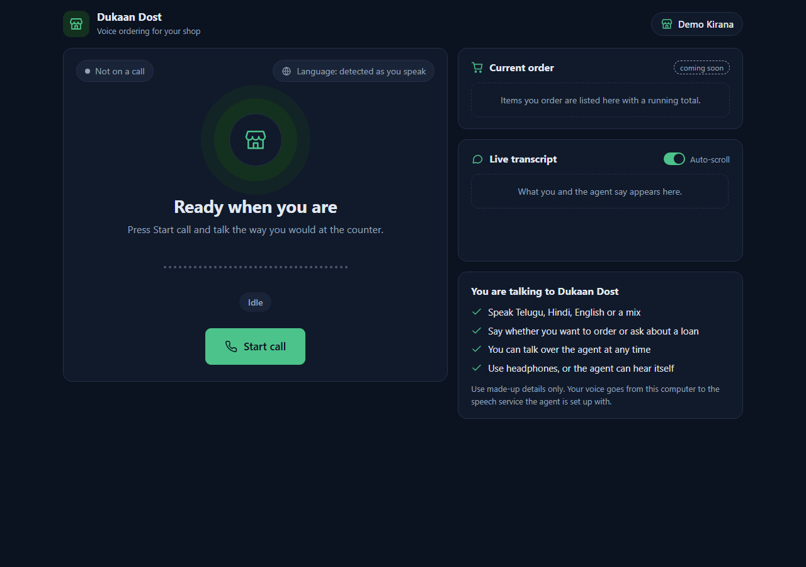</a> |
| Shop dashboard | phone 390 px | <a href="history/04-build-1005/dashboard/01-landing/light-phone-390.png"></a> | <a href="history/05-build-1006/dashboard/01-landing/light-phone-390.png">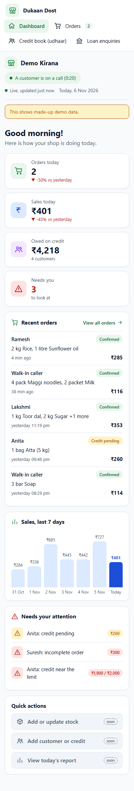</a> | <a href="history/04-build-1005/dashboard/01-landing/dark-phone-390.png"></a> | <a href="history/05-build-1006/dashboard/01-landing/dark-phone-390.png">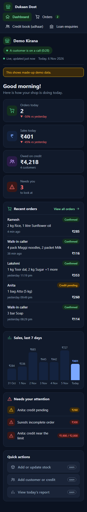</a> |
| Shop dashboard | desktop 1280 px | <a href="history/04-build-1005/dashboard/01-landing/light-desktop-1280.png"></a> | <a href="history/05-build-1006/dashboard/01-landing/light-desktop-1280.png">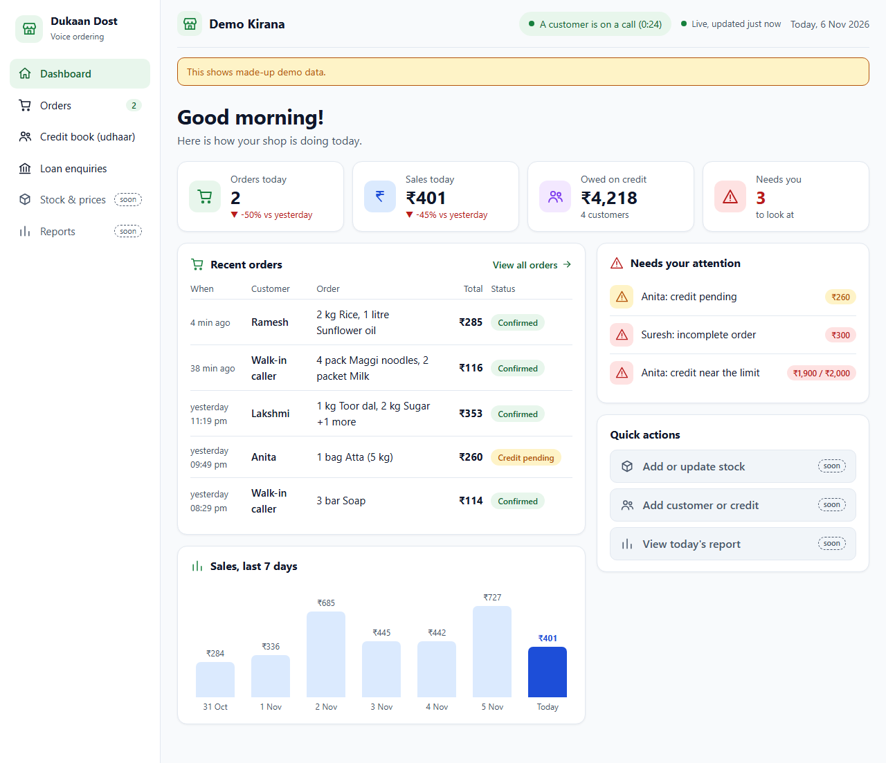</a> | <a href="history/04-build-1005/dashboard/01-landing/dark-desktop-1280.png"></a> | <a href="history/05-build-1006/dashboard/01-landing/dark-desktop-1280.png">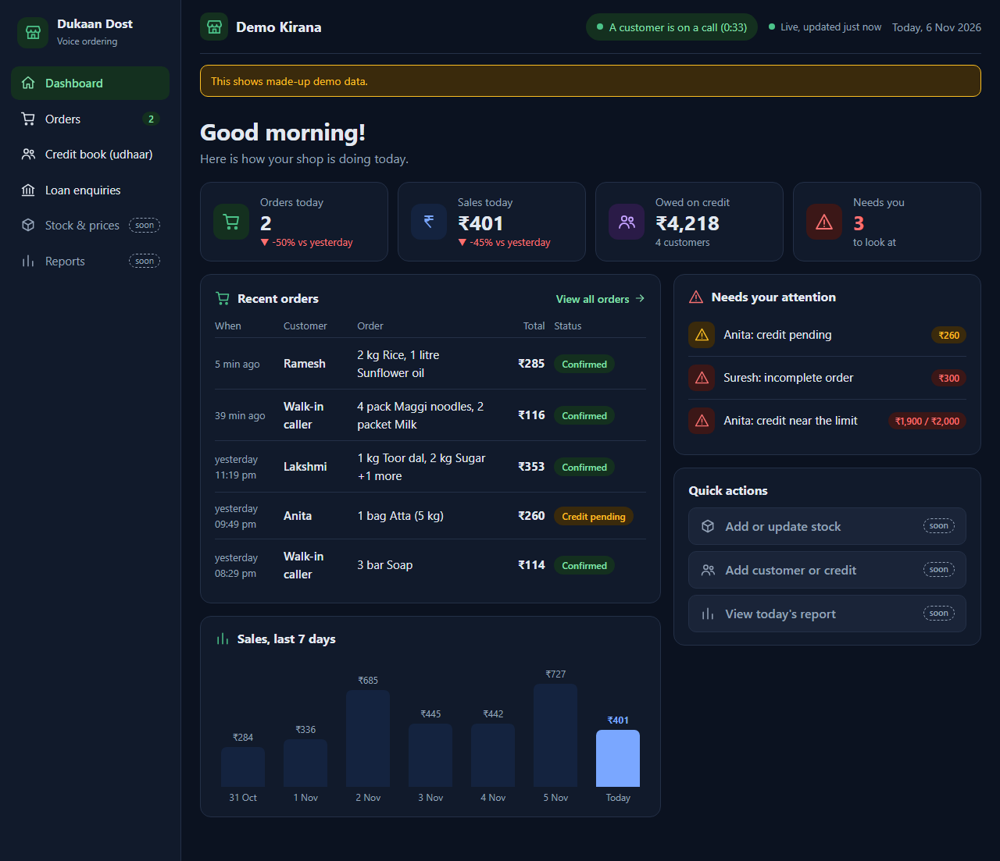</a> |

<a id="06-build-1007"></a>
## 06. Built from components: bento grid, glass and a drawer menu

Release `build-1007`, commit `5f45a9a`, 2026-11-02. Build report: [`MD/builds/build-1007.md`](../MD/builds/build-1007.md).

**On screen:** A new look: a bento grid with one big hero Sales tile, glass menu and bars over soft colour glows, hard-edged accents on the main button and figure, a drawer menu that can be hidden, and a Light / Dark / Auto switch.

What is different from the one before:

- Dashboard: three tiles with Sales today as the big hero, a floating curved side menu with a hide button, a Dark button in the top bar, glows behind the glass, a Sales chart beside Needs your attention.
- Call page: the same new look, with a Light / Dark button.
- Under the surface: the pages are now built from small components (a change you cannot see).

| Page | Shown | Light: before | Light: this release | Dark: before | Dark: this release |
|---|---|---|---|---|---|
| Call page | phone 390 px | <a href="history/05-build-1006/call-page/01-landing/light-phone-390.png"></a> | <a href="history/06-build-1007/call-page/01-landing/light-phone-390.png">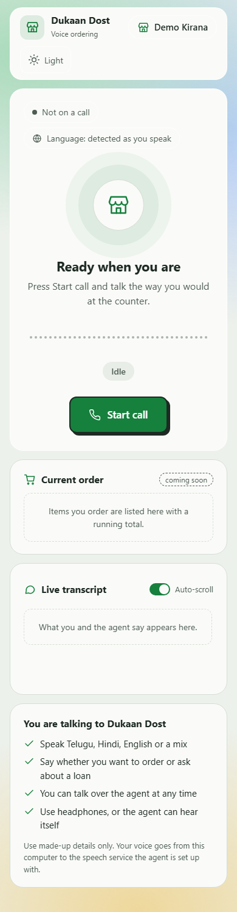</a> | <a href="history/05-build-1006/call-page/01-landing/dark-phone-390.png"></a> | <a href="history/06-build-1007/call-page/01-landing/dark-phone-390.png"></a> |
| Call page | desktop 1280 px | <a href="history/05-build-1006/call-page/01-landing/light-desktop-1280.png"></a> | <a href="history/06-build-1007/call-page/01-landing/light-desktop-1280.png"></a> | <a href="history/05-build-1006/call-page/01-landing/dark-desktop-1280.png"></a> | <a href="history/06-build-1007/call-page/01-landing/dark-desktop-1280.png"></a> |
| Shop dashboard | phone 390 px | <a href="history/05-build-1006/dashboard/01-landing/light-phone-390.png"></a> | <a href="history/06-build-1007/dashboard/01-landing/light-phone-390.png"></a> | <a href="history/05-build-1006/dashboard/01-landing/dark-phone-390.png"></a> | <a href="history/06-build-1007/dashboard/01-landing/dark-phone-390.png"></a> |
| Shop dashboard | desktop 1280 px | <a href="history/05-build-1006/dashboard/01-landing/light-desktop-1280.png"></a> | <a href="history/06-build-1007/dashboard/01-landing/light-desktop-1280.png"></a> | <a href="history/05-build-1006/dashboard/01-landing/dark-desktop-1280.png"></a> | <a href="history/06-build-1007/dashboard/01-landing/dark-desktop-1280.png">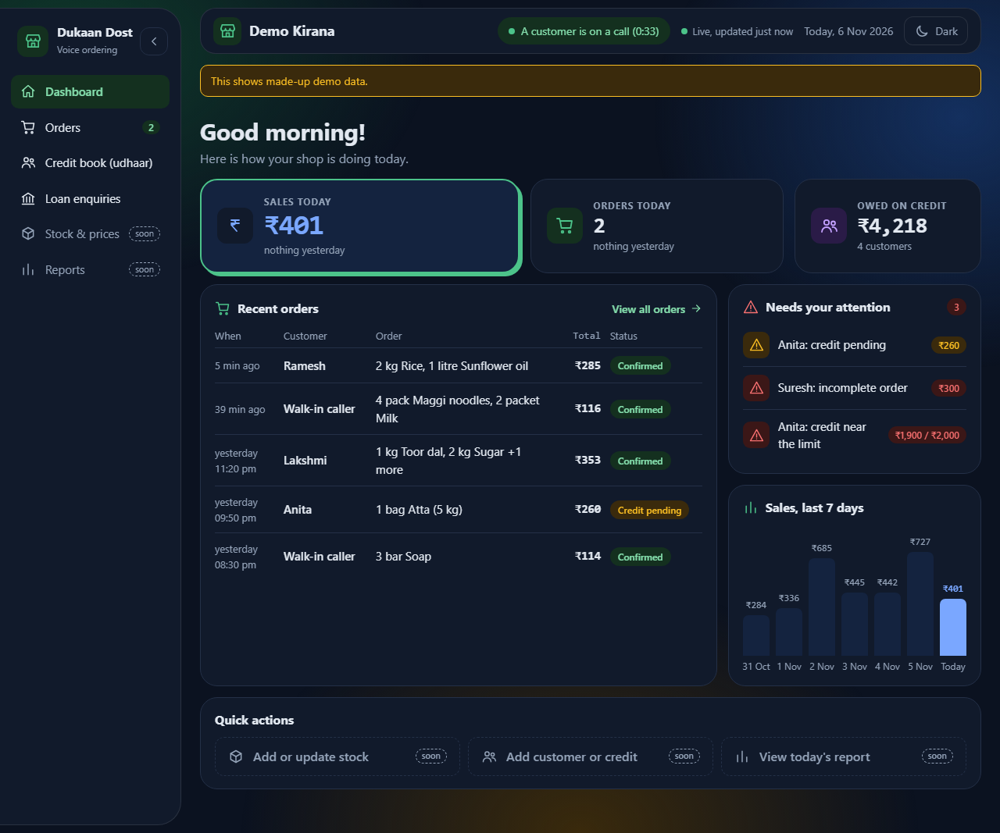</a> |

<a id="07-build-1009"></a>
## 07. The admin page appears

Release `build-1009`, commit `96aae4b`, 2026-11-03. Build report: [`MD/builds/build-1009.md`](../MD/builds/build-1009.md).

**On screen:** A new /admin page in the same look: four tiles (shops, calls now, to fix, orders today) and a list of every shop with its state and Edit, Shop dashboard and Call page buttons.

What is different from the one before:

- New page: Admin, with a menu of Overview, Problems and Add a shop.
- Each shop has a state pill (Ready, Needs attention, Broken) and the number of problems.

_Not looked at: this release's Add a shop, Edit and Problems views (today's versions of them are in snapshots/latest/admin/)._

| Page | Shown | Light: before | Light: this release | Dark: before | Dark: this release |
|---|---|---|---|---|---|
| Call page | phone 390 px | <a href="history/06-build-1007/call-page/01-landing/light-phone-390.png"></a> | <a href="history/07-build-1009/call-page/01-landing/light-phone-390.png"></a> | <a href="history/06-build-1007/call-page/01-landing/dark-phone-390.png"></a> | <a href="history/07-build-1009/call-page/01-landing/dark-phone-390.png"></a> |
| Call page | desktop 1280 px | <a href="history/06-build-1007/call-page/01-landing/light-desktop-1280.png"></a> | <a href="history/07-build-1009/call-page/01-landing/light-desktop-1280.png"></a> | <a href="history/06-build-1007/call-page/01-landing/dark-desktop-1280.png"></a> | <a href="history/07-build-1009/call-page/01-landing/dark-desktop-1280.png"></a> |
| Shop dashboard | phone 390 px | <a href="history/06-build-1007/dashboard/01-landing/light-phone-390.png"></a> | <a href="history/07-build-1009/dashboard/01-landing/light-phone-390.png"></a> | <a href="history/06-build-1007/dashboard/01-landing/dark-phone-390.png"></a> | <a href="history/07-build-1009/dashboard/01-landing/dark-phone-390.png"></a> |
| Shop dashboard | desktop 1280 px | <a href="history/06-build-1007/dashboard/01-landing/light-desktop-1280.png"></a> | <a href="history/07-build-1009/dashboard/01-landing/light-desktop-1280.png"></a> | <a href="history/06-build-1007/dashboard/01-landing/dark-desktop-1280.png"></a> | <a href="history/07-build-1009/dashboard/01-landing/dark-desktop-1280.png"></a> |
| Admin page | phone 390 px | (new page) | <a href="history/07-build-1009/admin/01-landing/light-phone-390.png">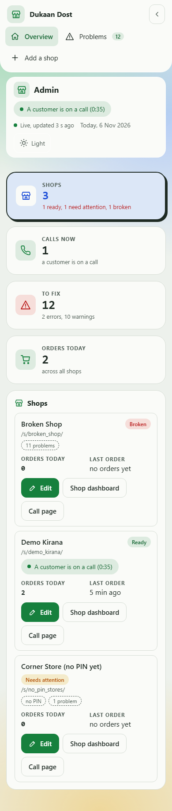</a> | (new page) | <a href="history/07-build-1009/admin/01-landing/dark-phone-390.png">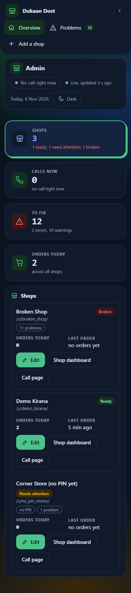</a> |
| Admin page | desktop 1280 px | (new page) | <a href="history/07-build-1009/admin/01-landing/light-desktop-1280.png">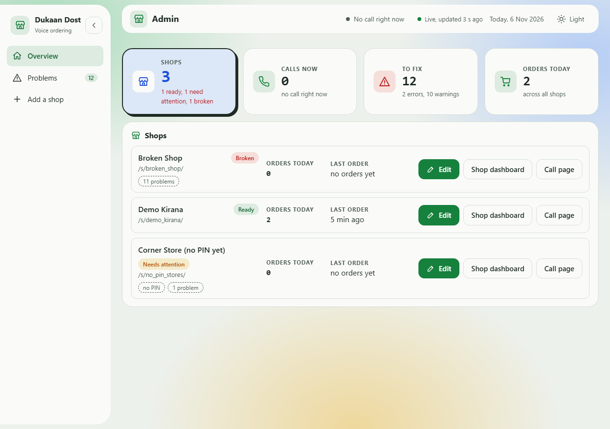</a> | (new page) | <a href="history/07-build-1009/admin/01-landing/dark-desktop-1280.png">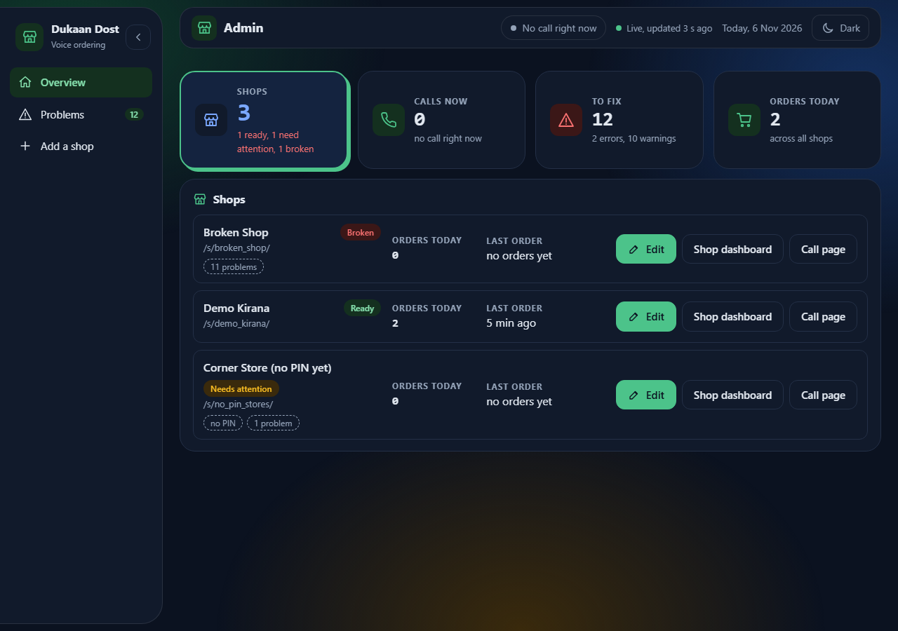</a> |

<a id="08-build-1010"></a>
## 08. The admin page goes dark, with search, tabs and a notice

Release `build-1010`, commit `0659a91`, 2026-11-03. Build report: [`MD/builds/build-1010.md`](../MD/builds/build-1010.md).

**On screen:** The admin page starts dark with near-black surfaces and a lime accent, and gets a search box, filter tabs with counts, a dismissable notice, overview panels, an Activity view and a Copy call link button.

What is different from the one before:

- Admin: near-black and lime instead of the green glass look; a Workspace label in the menu; a search box (Ctrl K); All / Ready / Needs attention / Broken tabs; a 'Some shops cannot take calls properly' notice; Needs attention and Recent activity panels at the bottom.
- The shop pages (call page and dashboard) are unchanged.

| Page | Shown | Light: before | Light: this release | Dark: before | Dark: this release |
|---|---|---|---|---|---|
| Call page | phone 390 px | <a href="history/07-build-1009/call-page/01-landing/light-phone-390.png"></a> | <a href="history/08-build-1010/call-page/01-landing/light-phone-390.png"></a> | <a href="history/07-build-1009/call-page/01-landing/dark-phone-390.png"></a> | <a href="history/08-build-1010/call-page/01-landing/dark-phone-390.png">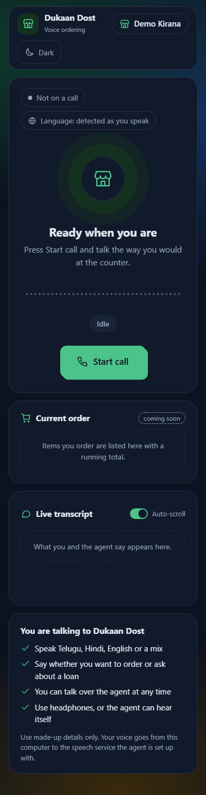</a> |
| Call page | desktop 1280 px | <a href="history/07-build-1009/call-page/01-landing/light-desktop-1280.png"></a> | <a href="history/08-build-1010/call-page/01-landing/light-desktop-1280.png">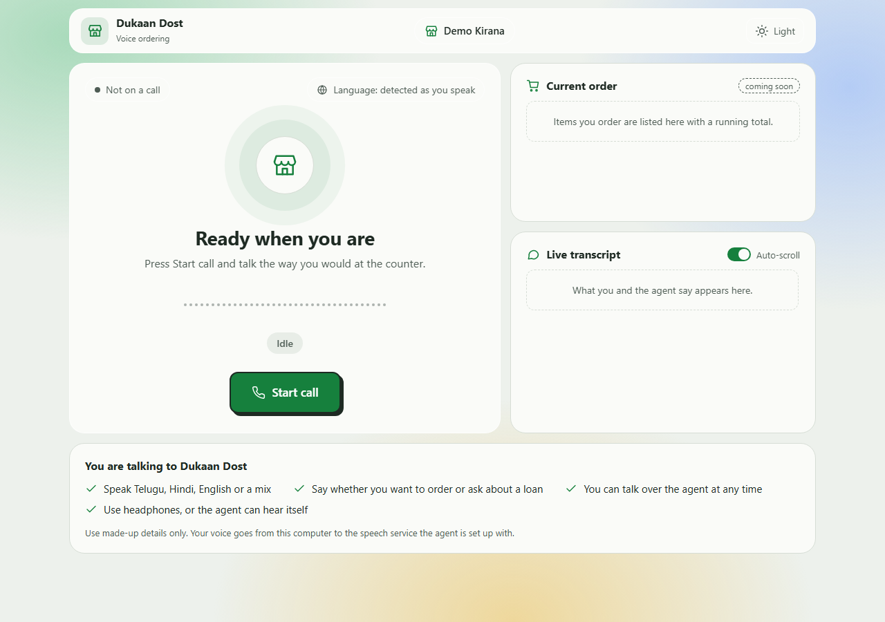</a> | <a href="history/07-build-1009/call-page/01-landing/dark-desktop-1280.png"></a> | <a href="history/08-build-1010/call-page/01-landing/dark-desktop-1280.png">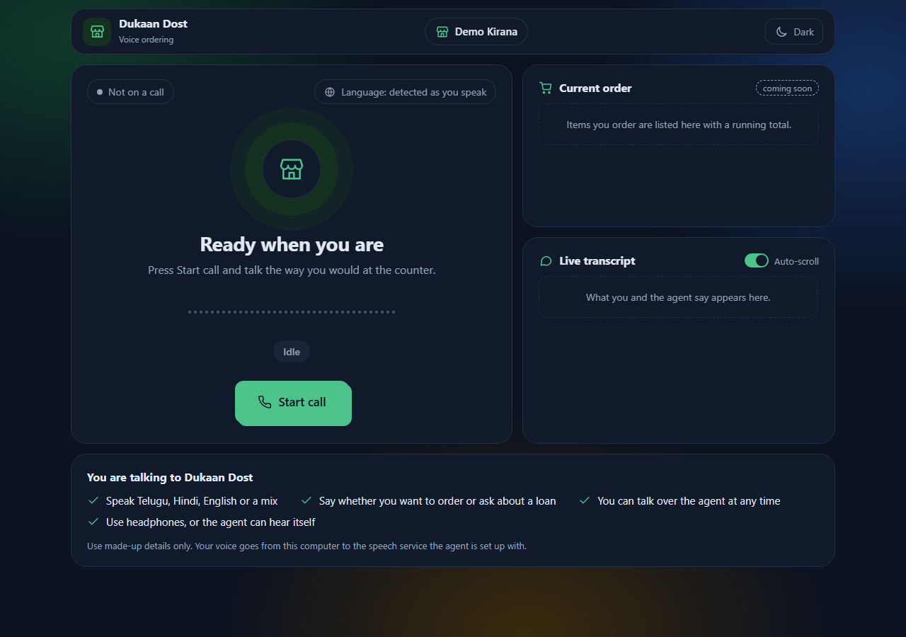</a> |
| Shop dashboard | phone 390 px | <a href="history/07-build-1009/dashboard/01-landing/light-phone-390.png"></a> | <a href="history/08-build-1010/dashboard/01-landing/light-phone-390.png"></a> | <a href="history/07-build-1009/dashboard/01-landing/dark-phone-390.png"></a> | <a href="history/08-build-1010/dashboard/01-landing/dark-phone-390.png">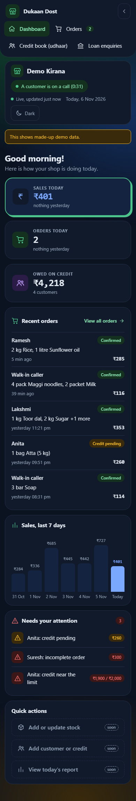</a> |
| Shop dashboard | desktop 1280 px | <a href="history/07-build-1009/dashboard/01-landing/light-desktop-1280.png"></a> | <a href="history/08-build-1010/dashboard/01-landing/light-desktop-1280.png"></a> | <a href="history/07-build-1009/dashboard/01-landing/dark-desktop-1280.png"></a> | <a href="history/08-build-1010/dashboard/01-landing/dark-desktop-1280.png"></a> |
| Admin page | phone 390 px | <a href="history/07-build-1009/admin/01-landing/light-phone-390.png"></a> | <a href="history/08-build-1010/admin/01-landing/light-phone-390.png">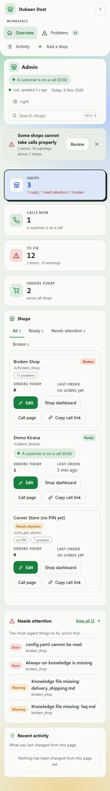</a> | <a href="history/07-build-1009/admin/01-landing/dark-phone-390.png"></a> | <a href="history/08-build-1010/admin/01-landing/dark-phone-390.png"></a> |
| Admin page | desktop 1280 px | <a href="history/07-build-1009/admin/01-landing/light-desktop-1280.png"></a> | <a href="history/08-build-1010/admin/01-landing/light-desktop-1280.png">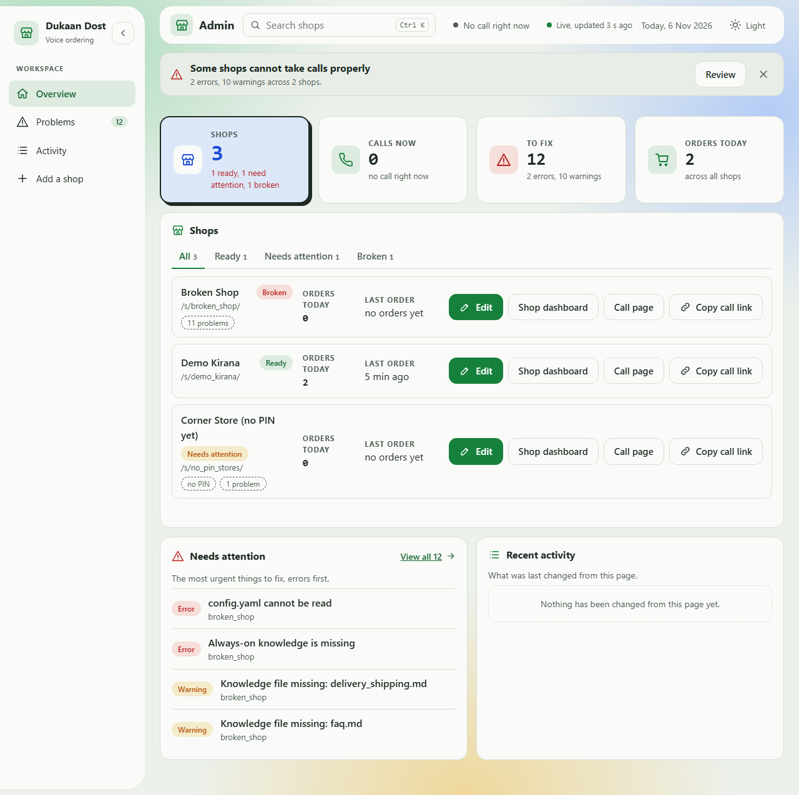</a> | <a href="history/07-build-1009/admin/01-landing/dark-desktop-1280.png"></a> | <a href="history/08-build-1010/admin/01-landing/dark-desktop-1280.png">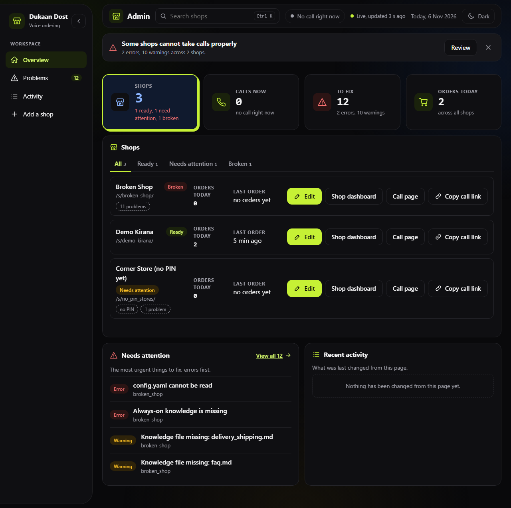</a> |

<a id="09-build-1011"></a>
## 09. The call page shows the loan quote

Release `build-1011`, commit `ce5900e`, 2026-11-03. Build report: [`MD/builds/build-1011.md`](../MD/builds/build-1011.md).

**On screen:** A Loan guidance panel appears on the call page. It is empty until a caller asks about a loan, then it shows the project cost, margin money, loan, scheme and rate, total interest and the monthly instalment, marked indicative.

What is different from the one before:

- Call page: a new 'Loan guidance' card between Current order and Live transcript, with an 'indicative' tag.
- The loan figures are not visible in this release's pictures, because they only appear during a call; see the quote states in snapshots/latest/call-page/.

| Page | Shown | Light: before | Light: this release | Dark: before | Dark: this release |
|---|---|---|---|---|---|
| Call page | phone 390 px | <a href="history/08-build-1010/call-page/01-landing/light-phone-390.png"></a> | <a href="history/09-build-1011/call-page/01-landing/light-phone-390.png">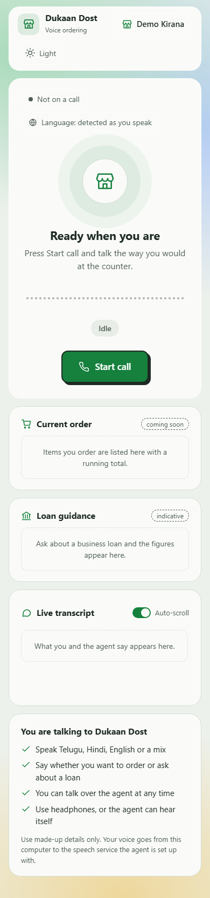</a> | <a href="history/08-build-1010/call-page/01-landing/dark-phone-390.png"></a> | <a href="history/09-build-1011/call-page/01-landing/dark-phone-390.png">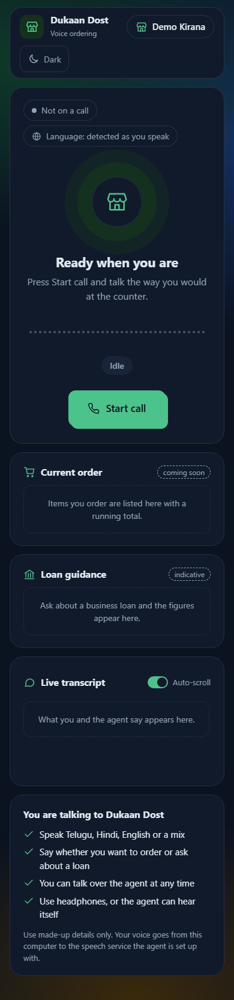</a> |
| Call page | desktop 1280 px | <a href="history/08-build-1010/call-page/01-landing/light-desktop-1280.png"></a> | <a href="history/09-build-1011/call-page/01-landing/light-desktop-1280.png">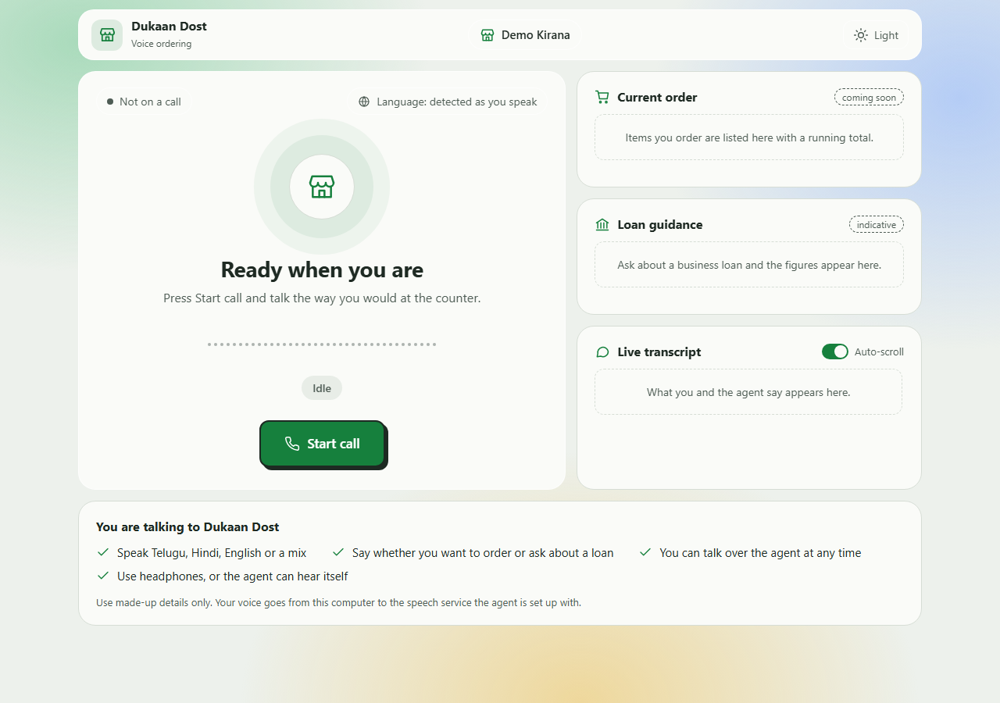</a> | <a href="history/08-build-1010/call-page/01-landing/dark-desktop-1280.png"></a> | <a href="history/09-build-1011/call-page/01-landing/dark-desktop-1280.png">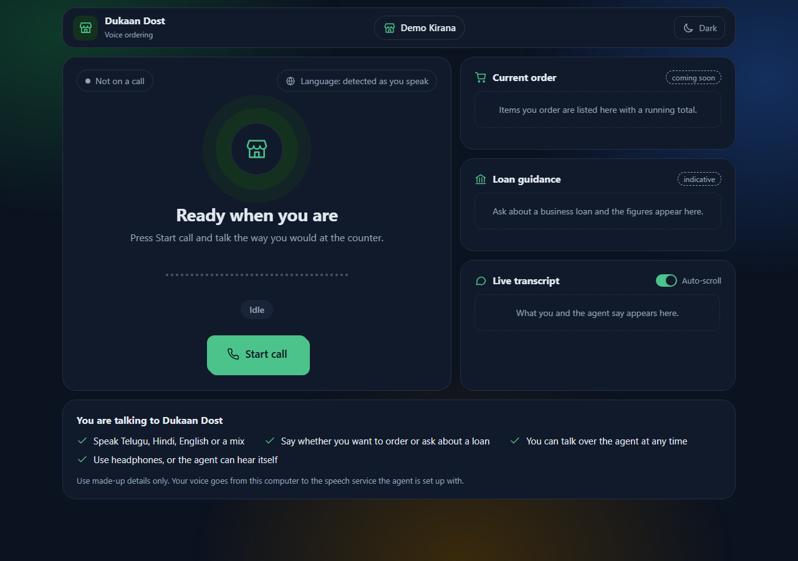</a> |
| Shop dashboard | phone 390 px | <a href="history/08-build-1010/dashboard/01-landing/light-phone-390.png"></a> | <a href="history/09-build-1011/dashboard/01-landing/light-phone-390.png">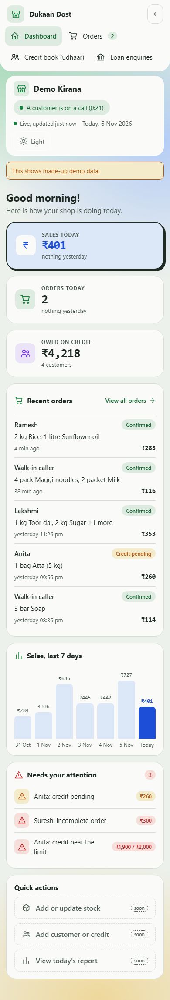</a> | <a href="history/08-build-1010/dashboard/01-landing/dark-phone-390.png"></a> | <a href="history/09-build-1011/dashboard/01-landing/dark-phone-390.png"></a> |
| Shop dashboard | desktop 1280 px | <a href="history/08-build-1010/dashboard/01-landing/light-desktop-1280.png"></a> | <a href="history/09-build-1011/dashboard/01-landing/light-desktop-1280.png">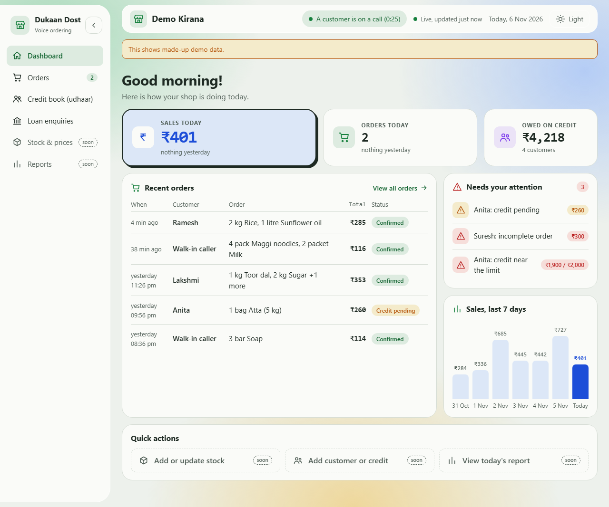</a> | <a href="history/08-build-1010/dashboard/01-landing/dark-desktop-1280.png"></a> | <a href="history/09-build-1011/dashboard/01-landing/dark-desktop-1280.png"></a> |
| Admin page | phone 390 px | <a href="history/08-build-1010/admin/01-landing/light-phone-390.png"></a> | <a href="history/09-build-1011/admin/01-landing/light-phone-390.png"></a> | <a href="history/08-build-1010/admin/01-landing/dark-phone-390.png"></a> | <a href="history/09-build-1011/admin/01-landing/dark-phone-390.png">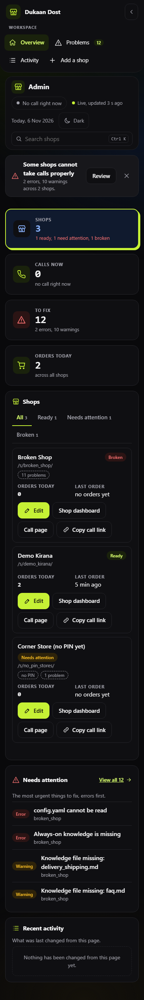</a> |
| Admin page | desktop 1280 px | <a href="history/08-build-1010/admin/01-landing/light-desktop-1280.png"></a> | <a href="history/09-build-1011/admin/01-landing/light-desktop-1280.png"></a> | <a href="history/08-build-1010/admin/01-landing/dark-desktop-1280.png"></a> | <a href="history/09-build-1011/admin/01-landing/dark-desktop-1280.png"></a> |

<a id="10-build-1012"></a>
## 10. One neutral charcoal palette on every page

Release `build-1012`, commit `965f4cf`, 2026-11-05. Build report: [`MD/builds/build-1012.md`](../MD/builds/build-1012.md).

**On screen:** All pages share one flat palette (charcoal in dark, off-white in light, one calm green): the coloured glows, the glass blur and the admin's lime accent are gone.

What is different from the one before:

- Every page: no coloured glows behind the cards and no blurred glass; surfaces are solid.
- Dark mode is charcoal, not navy. The admin page is no longer near-black and lime: it matches the other pages.
- The Start call button has a clear near-white edge in dark mode (it looked notched before).
- Bigger tap targets for the Auto-scroll switch, the admin search box, the hide-menu button and the notice close button (small, hard to see in a picture).

| Page | Shown | Light: before | Light: this release | Dark: before | Dark: this release |
|---|---|---|---|---|---|
| Call page | phone 390 px | <a href="history/09-build-1011/call-page/01-landing/light-phone-390.png"></a> | <a href="history/10-build-1012/call-page/01-landing/light-phone-390.png"></a> | <a href="history/09-build-1011/call-page/01-landing/dark-phone-390.png"></a> | <a href="history/10-build-1012/call-page/01-landing/dark-phone-390.png"></a> |
| Call page | desktop 1280 px | <a href="history/09-build-1011/call-page/01-landing/light-desktop-1280.png"></a> | <a href="history/10-build-1012/call-page/01-landing/light-desktop-1280.png"></a> | <a href="history/09-build-1011/call-page/01-landing/dark-desktop-1280.png"></a> | <a href="history/10-build-1012/call-page/01-landing/dark-desktop-1280.png"></a> |
| Shop dashboard | phone 390 px | <a href="history/09-build-1011/dashboard/01-landing/light-phone-390.png"></a> | <a href="history/10-build-1012/dashboard/01-landing/light-phone-390.png"></a> | <a href="history/09-build-1011/dashboard/01-landing/dark-phone-390.png"></a> | <a href="history/10-build-1012/dashboard/01-landing/dark-phone-390.png"></a> |
| Shop dashboard | desktop 1280 px | <a href="history/09-build-1011/dashboard/01-landing/light-desktop-1280.png"></a> | <a href="history/10-build-1012/dashboard/01-landing/light-desktop-1280.png"></a> | <a href="history/09-build-1011/dashboard/01-landing/dark-desktop-1280.png"></a> | <a href="history/10-build-1012/dashboard/01-landing/dark-desktop-1280.png"></a> |
| Admin page | phone 390 px | <a href="history/09-build-1011/admin/01-landing/light-phone-390.png"></a> | <a href="history/10-build-1012/admin/01-landing/light-phone-390.png"></a> | <a href="history/09-build-1011/admin/01-landing/dark-phone-390.png"></a> | <a href="history/10-build-1012/admin/01-landing/dark-phone-390.png"></a> |
| Admin page | desktop 1280 px | <a href="history/09-build-1011/admin/01-landing/light-desktop-1280.png"></a> | <a href="history/10-build-1012/admin/01-landing/light-desktop-1280.png"></a> | <a href="history/09-build-1011/admin/01-landing/dark-desktop-1280.png"></a> | <a href="history/10-build-1012/admin/01-landing/dark-desktop-1280.png"></a> |

<a id="11-build-1015"></a>
## 11. A sign-in page instead of the browser's box

Release `build-1015`, commit `e6c7390`, 2026-11-06. Build report: [`MD/builds/build-1015.md`](../MD/builds/build-1015.md).

**On screen:** Opening a dashboard while signed out now shows a proper sign-in card (PIN field with a show button, 'keep me signed in', tries left and a lockout countdown); the dashboard and admin top bars get a Sign out button.

What is different from the one before:

- New pages: Shop sign-in and Admin sign-in (the admin's starts dark).
- Dashboard and Admin: a 'Sign out' button next to the theme button in the top bar.
- Everything else looks the same as the release before.

_Not looked at: a real phone keyboard, a real password manager, and https. The sign-in error and locked states are in snapshots/latest/sign-in-shop/._

| Page | Shown | Light: before | Light: this release | Dark: before | Dark: this release |
|---|---|---|---|---|---|
| Call page | phone 390 px | <a href="history/10-build-1012/call-page/01-landing/light-phone-390.png"></a> | <a href="history/11-build-1015/call-page/01-landing/light-phone-390.png"></a> | <a href="history/10-build-1012/call-page/01-landing/dark-phone-390.png"></a> | <a href="history/11-build-1015/call-page/01-landing/dark-phone-390.png"></a> |
| Call page | desktop 1280 px | <a href="history/10-build-1012/call-page/01-landing/light-desktop-1280.png"></a> | <a href="history/11-build-1015/call-page/01-landing/light-desktop-1280.png"></a> | <a href="history/10-build-1012/call-page/01-landing/dark-desktop-1280.png"></a> | <a href="history/11-build-1015/call-page/01-landing/dark-desktop-1280.png"></a> |
| Shop dashboard | phone 390 px | <a href="history/10-build-1012/dashboard/01-landing/light-phone-390.png"></a> | <a href="history/11-build-1015/dashboard/01-landing/light-phone-390.png"></a> | <a href="history/10-build-1012/dashboard/01-landing/dark-phone-390.png"></a> | <a href="history/11-build-1015/dashboard/01-landing/dark-phone-390.png"></a> |
| Shop dashboard | desktop 1280 px | <a href="history/10-build-1012/dashboard/01-landing/light-desktop-1280.png"></a> | <a href="history/11-build-1015/dashboard/01-landing/light-desktop-1280.png"></a> | <a href="history/10-build-1012/dashboard/01-landing/dark-desktop-1280.png"></a> | <a href="history/11-build-1015/dashboard/01-landing/dark-desktop-1280.png"></a> |
| Admin page | phone 390 px | <a href="history/10-build-1012/admin/01-landing/light-phone-390.png"></a> | <a href="history/11-build-1015/admin/01-landing/light-phone-390.png"></a> | <a href="history/10-build-1012/admin/01-landing/dark-phone-390.png"></a> | <a href="history/11-build-1015/admin/01-landing/dark-phone-390.png"></a> |
| Admin page | desktop 1280 px | <a href="history/10-build-1012/admin/01-landing/light-desktop-1280.png"></a> | <a href="history/11-build-1015/admin/01-landing/light-desktop-1280.png"></a> | <a href="history/10-build-1012/admin/01-landing/dark-desktop-1280.png"></a> | <a href="history/11-build-1015/admin/01-landing/dark-desktop-1280.png"></a> |
| Shop sign-in | phone 390 px | (new page) | <a href="history/11-build-1015/sign-in-shop/01-landing/light-phone-390.png"></a> | (new page) | <a href="history/11-build-1015/sign-in-shop/01-landing/dark-phone-390.png"></a> |
| Shop sign-in | desktop 1280 px | (new page) | <a href="history/11-build-1015/sign-in-shop/01-landing/light-desktop-1280.png"></a> | (new page) | <a href="history/11-build-1015/sign-in-shop/01-landing/dark-desktop-1280.png"></a> |
| Admin sign-in | phone 390 px | (new page) | <a href="history/11-build-1015/sign-in-admin/01-landing/light-phone-390.png"></a> | (new page) | <a href="history/11-build-1015/sign-in-admin/01-landing/dark-phone-390.png"></a> |
| Admin sign-in | desktop 1280 px | (new page) | <a href="history/11-build-1015/sign-in-admin/01-landing/light-desktop-1280.png"></a> | (new page) | <a href="history/11-build-1015/sign-in-admin/01-landing/dark-desktop-1280.png"></a> |

<a id="12-build-1017"></a>
## 12. The dashboard links to the shop's call page

Release `build-1017`, commit `5694eaa`, 2026-11-08. Build report: [`MD/builds/build-1017.md`](../MD/builds/build-1017.md).

**On screen:** The dashboard's side menu gets a 'Call page' item with a phone icon, between Loan enquiries and Stock & prices; it opens that shop's own call page.

What is different from the one before:

- Dashboard: one new menu item, 'Call page'. Everything else looks the same as the release before.
- The figures, dates and order times differ only because the made-up demo data is generated for the day the picture was taken.

_Not looked at: the menu on a phone with the drawer open (the item is there; the landing picture shows the drawer closed)._

| Page | Shown | Light: before | Light: this release | Dark: before | Dark: this release |
|---|---|---|---|---|---|
| Call page | phone 390 px | <a href="history/11-build-1015/call-page/01-landing/light-phone-390.png"></a> | <a href="history/12-build-1017/call-page/01-landing/light-phone-390.png"></a> | <a href="history/11-build-1015/call-page/01-landing/dark-phone-390.png"></a> | <a href="history/12-build-1017/call-page/01-landing/dark-phone-390.png"></a> |
| Call page | desktop 1280 px | <a href="history/11-build-1015/call-page/01-landing/light-desktop-1280.png"></a> | <a href="history/12-build-1017/call-page/01-landing/light-desktop-1280.png"></a> | <a href="history/11-build-1015/call-page/01-landing/dark-desktop-1280.png"></a> | <a href="history/12-build-1017/call-page/01-landing/dark-desktop-1280.png"></a> |
| Shop dashboard | phone 390 px | <a href="history/11-build-1015/dashboard/01-landing/light-phone-390.png"></a> | <a href="history/12-build-1017/dashboard/01-landing/light-phone-390.png"></a> | <a href="history/11-build-1015/dashboard/01-landing/dark-phone-390.png"></a> | <a href="history/12-build-1017/dashboard/01-landing/dark-phone-390.png"></a> |
| Shop dashboard | desktop 1280 px | <a href="history/11-build-1015/dashboard/01-landing/light-desktop-1280.png"></a> | <a href="history/12-build-1017/dashboard/01-landing/light-desktop-1280.png"></a> | <a href="history/11-build-1015/dashboard/01-landing/dark-desktop-1280.png"></a> | <a href="history/12-build-1017/dashboard/01-landing/dark-desktop-1280.png"></a> |
| Admin page | phone 390 px | <a href="history/11-build-1015/admin/01-landing/light-phone-390.png"></a> | <a href="history/12-build-1017/admin/01-landing/light-phone-390.png"></a> | <a href="history/11-build-1015/admin/01-landing/dark-phone-390.png"></a> | <a href="history/12-build-1017/admin/01-landing/dark-phone-390.png"></a> |
| Admin page | desktop 1280 px | <a href="history/11-build-1015/admin/01-landing/light-desktop-1280.png"></a> | <a href="history/12-build-1017/admin/01-landing/light-desktop-1280.png"></a> | <a href="history/11-build-1015/admin/01-landing/dark-desktop-1280.png"></a> | <a href="history/12-build-1017/admin/01-landing/dark-desktop-1280.png"></a> |
| Shop sign-in | phone 390 px | <a href="history/11-build-1015/sign-in-shop/01-landing/light-phone-390.png"></a> | <a href="history/12-build-1017/sign-in-shop/01-landing/light-phone-390.png"></a> | <a href="history/11-build-1015/sign-in-shop/01-landing/dark-phone-390.png"></a> | <a href="history/12-build-1017/sign-in-shop/01-landing/dark-phone-390.png"></a> |
| Shop sign-in | desktop 1280 px | <a href="history/11-build-1015/sign-in-shop/01-landing/light-desktop-1280.png"></a> | <a href="history/12-build-1017/sign-in-shop/01-landing/light-desktop-1280.png"></a> | <a href="history/11-build-1015/sign-in-shop/01-landing/dark-desktop-1280.png"></a> | <a href="history/12-build-1017/sign-in-shop/01-landing/dark-desktop-1280.png"></a> |
| Admin sign-in | phone 390 px | <a href="history/11-build-1015/sign-in-admin/01-landing/light-phone-390.png"></a> | <a href="history/12-build-1017/sign-in-admin/01-landing/light-phone-390.png"></a> | <a href="history/11-build-1015/sign-in-admin/01-landing/dark-phone-390.png"></a> | <a href="history/12-build-1017/sign-in-admin/01-landing/dark-phone-390.png"></a> |
| Admin sign-in | desktop 1280 px | <a href="history/11-build-1015/sign-in-admin/01-landing/light-desktop-1280.png"></a> | <a href="history/12-build-1017/sign-in-admin/01-landing/light-desktop-1280.png"></a> | <a href="history/11-build-1015/sign-in-admin/01-landing/dark-desktop-1280.png"></a> | <a href="history/12-build-1017/sign-in-admin/01-landing/dark-desktop-1280.png"></a> |

<a id="13-build-1018"></a>
## 13. A Calls view, and highlights taken from the shop's own books

Release `build-1018`, commit `a028be7`, 2026-11-08. Build report: [`MD/builds/build-1018.md`](../MD/builds/build-1018.md).

**On screen:** Every page marks things its own way instead of tinted pills, rows and dots: statuses are tabs on a card's edge, the desktop menu's open item is a tab into the page, counts are small tabs, the demo note is a paper slip, and a live call is a notched green tab on the dashboard and an outlined box with a pen caret elsewhere. The dashboard gets a Calls menu item.

What is different from the one before:

- Dashboard: the open menu item is a tab joined to the page; Orders and Calls counts are small dark tabs; the demo-data note is a paper slip with a NOTE label; a live call is a solid green tab with a notch; 'Live, updated' has a green edge instead of a dot; statuses in Recent orders are solid tabs.
- Admin: the same menu tab and count tabs; 'Needs a look' is a card with a red tab label; each shop's state is a tab standing on its card's edge; the filter tabs are ruled off twice; a live call is an outlined green box with a caret.
- Call page: squared chips and shop name; the call state (IDLE) and the COMING SOON and INDICATIVE labels are straight ruled capitals.
- Sign-in pages: look the same as the release before.
- Phone: the menu marks the open item with a double underline and shows counts as figures behind a rule.

_Not looked at: the Calls view itself, which is not a landing view (it is in snapshots/latest/dashboard/05-calls/); the two prototypes are in snapshots/prototypes/._

| Page | Shown | Light: before | Light: this release | Dark: before | Dark: this release |
|---|---|---|---|---|---|
| Call page | phone 390 px | <a href="history/12-build-1017/call-page/01-landing/light-phone-390.png"></a> | <a href="history/13-build-1018/call-page/01-landing/light-phone-390.png"></a> | <a href="history/12-build-1017/call-page/01-landing/dark-phone-390.png"></a> | <a href="history/13-build-1018/call-page/01-landing/dark-phone-390.png"></a> |
| Call page | desktop 1280 px | <a href="history/12-build-1017/call-page/01-landing/light-desktop-1280.png"></a> | <a href="history/13-build-1018/call-page/01-landing/light-desktop-1280.png"></a> | <a href="history/12-build-1017/call-page/01-landing/dark-desktop-1280.png"></a> | <a href="history/13-build-1018/call-page/01-landing/dark-desktop-1280.png"></a> |
| Shop dashboard | phone 390 px | <a href="history/12-build-1017/dashboard/01-landing/light-phone-390.png"></a> | <a href="history/13-build-1018/dashboard/01-landing/light-phone-390.png"></a> | <a href="history/12-build-1017/dashboard/01-landing/dark-phone-390.png"></a> | <a href="history/13-build-1018/dashboard/01-landing/dark-phone-390.png"></a> |
| Shop dashboard | desktop 1280 px | <a href="history/12-build-1017/dashboard/01-landing/light-desktop-1280.png"></a> | <a href="history/13-build-1018/dashboard/01-landing/light-desktop-1280.png"></a> | <a href="history/12-build-1017/dashboard/01-landing/dark-desktop-1280.png"></a> | <a href="history/13-build-1018/dashboard/01-landing/dark-desktop-1280.png"></a> |
| Admin page | phone 390 px | <a href="history/12-build-1017/admin/01-landing/light-phone-390.png"></a> | <a href="history/13-build-1018/admin/01-landing/light-phone-390.png"></a> | <a href="history/12-build-1017/admin/01-landing/dark-phone-390.png"></a> | <a href="history/13-build-1018/admin/01-landing/dark-phone-390.png"></a> |
| Admin page | desktop 1280 px | <a href="history/12-build-1017/admin/01-landing/light-desktop-1280.png"></a> | <a href="history/13-build-1018/admin/01-landing/light-desktop-1280.png"></a> | <a href="history/12-build-1017/admin/01-landing/dark-desktop-1280.png"></a> | <a href="history/13-build-1018/admin/01-landing/dark-desktop-1280.png"></a> |
| Shop sign-in | phone 390 px | <a href="history/12-build-1017/sign-in-shop/01-landing/light-phone-390.png"></a> | <a href="history/13-build-1018/sign-in-shop/01-landing/light-phone-390.png"></a> | <a href="history/12-build-1017/sign-in-shop/01-landing/dark-phone-390.png"></a> | <a href="history/13-build-1018/sign-in-shop/01-landing/dark-phone-390.png"></a> |
| Shop sign-in | desktop 1280 px | <a href="history/12-build-1017/sign-in-shop/01-landing/light-desktop-1280.png"></a> | <a href="history/13-build-1018/sign-in-shop/01-landing/light-desktop-1280.png"></a> | <a href="history/12-build-1017/sign-in-shop/01-landing/dark-desktop-1280.png"></a> | <a href="history/13-build-1018/sign-in-shop/01-landing/dark-desktop-1280.png"></a> |
| Admin sign-in | phone 390 px | <a href="history/12-build-1017/sign-in-admin/01-landing/light-phone-390.png"></a> | <a href="history/13-build-1018/sign-in-admin/01-landing/light-phone-390.png"></a> | <a href="history/12-build-1017/sign-in-admin/01-landing/dark-phone-390.png"></a> | <a href="history/13-build-1018/sign-in-admin/01-landing/dark-phone-390.png"></a> |
| Admin sign-in | desktop 1280 px | <a href="history/12-build-1017/sign-in-admin/01-landing/light-desktop-1280.png"></a> | <a href="history/13-build-1018/sign-in-admin/01-landing/light-desktop-1280.png"></a> | <a href="history/12-build-1017/sign-in-admin/01-landing/dark-desktop-1280.png"></a> | <a href="history/13-build-1018/sign-in-admin/01-landing/dark-desktop-1280.png"></a> |

<a id="14-build-1020"></a>
## 14. A clearer live label, and fixes from a full UI test pass

Release `build-1020`, commit `e332cb8`, 2026-11-09. Build report: [`MD/builds/build-1020.md`](../MD/builds/build-1020.md).

**On screen:** The freshness of the data is a small tab with a word in it, a green LIVE or a red OFFLINE, then the time in plain text; the dot, the thin green edge and the blinking caret are gone. Notes on a call card lose their line. An ordered call links to its order.

What is different from the one before:

- Dashboard and admin top bars: 'LIVE' in a small green tab before 'Updated 2 s ago' (it was a thin green edge before 'Live, updated 2 s ago').
- Admin and call page: the live-call box is an outlined green box with bold green words and no mark in front of them.
- Calls view: an ordered call has a 'View order' link (not in the landing pictures, which show the overview); the notes have no line beside them.
- Everything else looks the same as the release before: the fixes (long text wrapping, the admin search at 130% zoom, hidden icons, announced notices) are not visible in a picture.

_Not looked at: the Calls view and the offline state, which are not landing views (see snapshots/latest/dashboard/05-calls/); a real phone._

| Page | Shown | Light: before | Light: this release | Dark: before | Dark: this release |
|---|---|---|---|---|---|
| Call page | phone 390 px | <a href="history/13-build-1018/call-page/01-landing/light-phone-390.png"></a> | <a href="history/14-build-1020/call-page/01-landing/light-phone-390.png"></a> | <a href="history/13-build-1018/call-page/01-landing/dark-phone-390.png"></a> | <a href="history/14-build-1020/call-page/01-landing/dark-phone-390.png"></a> |
| Call page | desktop 1280 px | <a href="history/13-build-1018/call-page/01-landing/light-desktop-1280.png"></a> | <a href="history/14-build-1020/call-page/01-landing/light-desktop-1280.png"></a> | <a href="history/13-build-1018/call-page/01-landing/dark-desktop-1280.png"></a> | <a href="history/14-build-1020/call-page/01-landing/dark-desktop-1280.png"></a> |
| Shop dashboard | phone 390 px | <a href="history/13-build-1018/dashboard/01-landing/light-phone-390.png"></a> | <a href="history/14-build-1020/dashboard/01-landing/light-phone-390.png"></a> | <a href="history/13-build-1018/dashboard/01-landing/dark-phone-390.png"></a> | <a href="history/14-build-1020/dashboard/01-landing/dark-phone-390.png"></a> |
| Shop dashboard | desktop 1280 px | <a href="history/13-build-1018/dashboard/01-landing/light-desktop-1280.png"></a> | <a href="history/14-build-1020/dashboard/01-landing/light-desktop-1280.png"></a> | <a href="history/13-build-1018/dashboard/01-landing/dark-desktop-1280.png"></a> | <a href="history/14-build-1020/dashboard/01-landing/dark-desktop-1280.png"></a> |
| Admin page | phone 390 px | <a href="history/13-build-1018/admin/01-landing/light-phone-390.png"></a> | <a href="history/14-build-1020/admin/01-landing/light-phone-390.png"></a> | <a href="history/13-build-1018/admin/01-landing/dark-phone-390.png"></a> | <a href="history/14-build-1020/admin/01-landing/dark-phone-390.png"></a> |
| Admin page | desktop 1280 px | <a href="history/13-build-1018/admin/01-landing/light-desktop-1280.png"></a> | <a href="history/14-build-1020/admin/01-landing/light-desktop-1280.png"></a> | <a href="history/13-build-1018/admin/01-landing/dark-desktop-1280.png"></a> | <a href="history/14-build-1020/admin/01-landing/dark-desktop-1280.png"></a> |
| Shop sign-in | phone 390 px | <a href="history/13-build-1018/sign-in-shop/01-landing/light-phone-390.png"></a> | <a href="history/14-build-1020/sign-in-shop/01-landing/light-phone-390.png"></a> | <a href="history/13-build-1018/sign-in-shop/01-landing/dark-phone-390.png"></a> | <a href="history/14-build-1020/sign-in-shop/01-landing/dark-phone-390.png"></a> |
| Shop sign-in | desktop 1280 px | <a href="history/13-build-1018/sign-in-shop/01-landing/light-desktop-1280.png"></a> | <a href="history/14-build-1020/sign-in-shop/01-landing/light-desktop-1280.png"></a> | <a href="history/13-build-1018/sign-in-shop/01-landing/dark-desktop-1280.png"></a> | <a href="history/14-build-1020/sign-in-shop/01-landing/dark-desktop-1280.png"></a> |
| Admin sign-in | phone 390 px | <a href="history/13-build-1018/sign-in-admin/01-landing/light-phone-390.png"></a> | <a href="history/14-build-1020/sign-in-admin/01-landing/light-phone-390.png"></a> | <a href="history/13-build-1018/sign-in-admin/01-landing/dark-phone-390.png"></a> | <a href="history/14-build-1020/sign-in-admin/01-landing/dark-phone-390.png"></a> |
| Admin sign-in | desktop 1280 px | <a href="history/13-build-1018/sign-in-admin/01-landing/light-desktop-1280.png"></a> | <a href="history/14-build-1020/sign-in-admin/01-landing/light-desktop-1280.png"></a> | <a href="history/13-build-1018/sign-in-admin/01-landing/dark-desktop-1280.png"></a> | <a href="history/14-build-1020/sign-in-admin/01-landing/dark-desktop-1280.png"></a> |

<a id="15-build-1022"></a>
## 15. A first-visit tour, and empty lists that say what will appear

Release `build-1022`, commit `64bd5e4`, 2026-11-09. Build report: [`MD/builds/build-1022.md`](../MD/builds/build-1022.md).

**On screen:** The shop dashboard gets a menu item, Take the tour, and a four-step tour on a first visit; empty lists carry a title, a sentence on what will appear and a way to start.

What is different from the one before:

- Dashboard: a new 'Take the tour' item at the bottom of the menu (a question-mark icon).
- Everything else in the landing pictures looks the same as the release before: the tour only shows on a first visit, which these pictures are not, and the empty lists only show for a shop with nothing in it (see snapshots/latest/dashboard/06-tour-step-1, 07-tour-step-3, 08-empty-orders, 09-empty-calls).

_Not looked at: the tour and the empty lists, because they are not landing views; a real phone._

| Page | Shown | Light: before | Light: this release | Dark: before | Dark: this release |
|---|---|---|---|---|---|
| Call page | phone 390 px | <a href="history/14-build-1020/call-page/01-landing/light-phone-390.png"></a> | <a href="history/15-build-1022/call-page/01-landing/light-phone-390.png"></a> | <a href="history/14-build-1020/call-page/01-landing/dark-phone-390.png"></a> | <a href="history/15-build-1022/call-page/01-landing/dark-phone-390.png"></a> |
| Call page | desktop 1280 px | <a href="history/14-build-1020/call-page/01-landing/light-desktop-1280.png"></a> | <a href="history/15-build-1022/call-page/01-landing/light-desktop-1280.png"></a> | <a href="history/14-build-1020/call-page/01-landing/dark-desktop-1280.png"></a> | <a href="history/15-build-1022/call-page/01-landing/dark-desktop-1280.png"></a> |
| Shop dashboard | phone 390 px | <a href="history/14-build-1020/dashboard/01-landing/light-phone-390.png"></a> | <a href="history/15-build-1022/dashboard/01-landing/light-phone-390.png"></a> | <a href="history/14-build-1020/dashboard/01-landing/dark-phone-390.png"></a> | <a href="history/15-build-1022/dashboard/01-landing/dark-phone-390.png"></a> |
| Shop dashboard | desktop 1280 px | <a href="history/14-build-1020/dashboard/01-landing/light-desktop-1280.png"></a> | <a href="history/15-build-1022/dashboard/01-landing/light-desktop-1280.png"></a> | <a href="history/14-build-1020/dashboard/01-landing/dark-desktop-1280.png"></a> | <a href="history/15-build-1022/dashboard/01-landing/dark-desktop-1280.png"></a> |
| Admin page | phone 390 px | <a href="history/14-build-1020/admin/01-landing/light-phone-390.png"></a> | <a href="history/15-build-1022/admin/01-landing/light-phone-390.png"></a> | <a href="history/14-build-1020/admin/01-landing/dark-phone-390.png"></a> | <a href="history/15-build-1022/admin/01-landing/dark-phone-390.png"></a> |
| Admin page | desktop 1280 px | <a href="history/14-build-1020/admin/01-landing/light-desktop-1280.png"></a> | <a href="history/15-build-1022/admin/01-landing/light-desktop-1280.png"></a> | <a href="history/14-build-1020/admin/01-landing/dark-desktop-1280.png"></a> | <a href="history/15-build-1022/admin/01-landing/dark-desktop-1280.png"></a> |
| Shop sign-in | phone 390 px | <a href="history/14-build-1020/sign-in-shop/01-landing/light-phone-390.png"></a> | <a href="history/15-build-1022/sign-in-shop/01-landing/light-phone-390.png"></a> | <a href="history/14-build-1020/sign-in-shop/01-landing/dark-phone-390.png"></a> | <a href="history/15-build-1022/sign-in-shop/01-landing/dark-phone-390.png"></a> |
| Shop sign-in | desktop 1280 px | <a href="history/14-build-1020/sign-in-shop/01-landing/light-desktop-1280.png"></a> | <a href="history/15-build-1022/sign-in-shop/01-landing/light-desktop-1280.png"></a> | <a href="history/14-build-1020/sign-in-shop/01-landing/dark-desktop-1280.png"></a> | <a href="history/15-build-1022/sign-in-shop/01-landing/dark-desktop-1280.png"></a> |
| Admin sign-in | phone 390 px | <a href="history/14-build-1020/sign-in-admin/01-landing/light-phone-390.png"></a> | <a href="history/15-build-1022/sign-in-admin/01-landing/light-phone-390.png"></a> | <a href="history/14-build-1020/sign-in-admin/01-landing/dark-phone-390.png"></a> | <a href="history/15-build-1022/sign-in-admin/01-landing/dark-phone-390.png"></a> |
| Admin sign-in | desktop 1280 px | <a href="history/14-build-1020/sign-in-admin/01-landing/light-desktop-1280.png"></a> | <a href="history/15-build-1022/sign-in-admin/01-landing/light-desktop-1280.png"></a> | <a href="history/14-build-1020/sign-in-admin/01-landing/dark-desktop-1280.png"></a> | <a href="history/15-build-1022/sign-in-admin/01-landing/dark-desktop-1280.png"></a> |

<a id="16-build-1024"></a>
## 16. The pages hold together when zoomed in on a phone

Release `build-1024`, commit `802a815`, 2026-11-09. Build report: [`MD/builds/build-1024.md`](../MD/builds/build-1024.md).

**On screen:** Layout changes that only show in a very narrow window (a 390 px phone at 150% or 200% browser zoom): orders stack into one column, tile figures stay whole, panel tags drop under their title. The landing pictures at 390 and 1280 px look the same.

What is different from the one before:

- No difference at 390 px and 1280 px, which are the sizes these pictures show.
- At 195 and 260 px (zoomed in) the dashboard's Recent orders, tiles, Needs your attention, 7-day chart and Quick actions, the call page's panel headings and the admin notice are laid out differently; see snapshots/latest/ and the 'Zoom' section of MD/frontend.md.

_Not looked at: a real phone at 200% zoom; this release's history pictures do not include the zoomed widths._

| Page | Shown | Light: before | Light: this release | Dark: before | Dark: this release |
|---|---|---|---|---|---|
| Call page | phone 390 px | <a href="history/15-build-1022/call-page/01-landing/light-phone-390.png"></a> | <a href="history/16-build-1024/call-page/01-landing/light-phone-390.png"></a> | <a href="history/15-build-1022/call-page/01-landing/dark-phone-390.png"></a> | <a href="history/16-build-1024/call-page/01-landing/dark-phone-390.png"></a> |
| Call page | desktop 1280 px | <a href="history/15-build-1022/call-page/01-landing/light-desktop-1280.png"></a> | <a href="history/16-build-1024/call-page/01-landing/light-desktop-1280.png"></a> | <a href="history/15-build-1022/call-page/01-landing/dark-desktop-1280.png"></a> | <a href="history/16-build-1024/call-page/01-landing/dark-desktop-1280.png"></a> |
| Shop dashboard | phone 390 px | <a href="history/15-build-1022/dashboard/01-landing/light-phone-390.png"></a> | <a href="history/16-build-1024/dashboard/01-landing/light-phone-390.png"></a> | <a href="history/15-build-1022/dashboard/01-landing/dark-phone-390.png"></a> | <a href="history/16-build-1024/dashboard/01-landing/dark-phone-390.png"></a> |
| Shop dashboard | desktop 1280 px | <a href="history/15-build-1022/dashboard/01-landing/light-desktop-1280.png"></a> | <a href="history/16-build-1024/dashboard/01-landing/light-desktop-1280.png"></a> | <a href="history/15-build-1022/dashboard/01-landing/dark-desktop-1280.png"></a> | <a href="history/16-build-1024/dashboard/01-landing/dark-desktop-1280.png"></a> |
| Admin page | phone 390 px | <a href="history/15-build-1022/admin/01-landing/light-phone-390.png"></a> | <a href="history/16-build-1024/admin/01-landing/light-phone-390.png"></a> | <a href="history/15-build-1022/admin/01-landing/dark-phone-390.png"></a> | <a href="history/16-build-1024/admin/01-landing/dark-phone-390.png"></a> |
| Admin page | desktop 1280 px | <a href="history/15-build-1022/admin/01-landing/light-desktop-1280.png"></a> | <a href="history/16-build-1024/admin/01-landing/light-desktop-1280.png"></a> | <a href="history/15-build-1022/admin/01-landing/dark-desktop-1280.png"></a> | <a href="history/16-build-1024/admin/01-landing/dark-desktop-1280.png"></a> |
| Shop sign-in | phone 390 px | <a href="history/15-build-1022/sign-in-shop/01-landing/light-phone-390.png"></a> | <a href="history/16-build-1024/sign-in-shop/01-landing/light-phone-390.png"></a> | <a href="history/15-build-1022/sign-in-shop/01-landing/dark-phone-390.png"></a> | <a href="history/16-build-1024/sign-in-shop/01-landing/dark-phone-390.png"></a> |
| Shop sign-in | desktop 1280 px | <a href="history/15-build-1022/sign-in-shop/01-landing/light-desktop-1280.png"></a> | <a href="history/16-build-1024/sign-in-shop/01-landing/light-desktop-1280.png"></a> | <a href="history/15-build-1022/sign-in-shop/01-landing/dark-desktop-1280.png"></a> | <a href="history/16-build-1024/sign-in-shop/01-landing/dark-desktop-1280.png"></a> |
| Admin sign-in | phone 390 px | <a href="history/15-build-1022/sign-in-admin/01-landing/light-phone-390.png"></a> | <a href="history/16-build-1024/sign-in-admin/01-landing/light-phone-390.png"></a> | <a href="history/15-build-1022/sign-in-admin/01-landing/dark-phone-390.png"></a> | <a href="history/16-build-1024/sign-in-admin/01-landing/dark-phone-390.png"></a> |
| Admin sign-in | desktop 1280 px | <a href="history/15-build-1022/sign-in-admin/01-landing/light-desktop-1280.png"></a> | <a href="history/16-build-1024/sign-in-admin/01-landing/light-desktop-1280.png"></a> | <a href="history/15-build-1022/sign-in-admin/01-landing/dark-desktop-1280.png"></a> | <a href="history/16-build-1024/sign-in-admin/01-landing/dark-desktop-1280.png"></a> |

## Adding the next release

After a build that changes how a page looks:

```
python scripts/ui_check/snapshot_release.py build-1025 17-build-1025     # the new build, from git
# add an entry for "17-build-1025" to snapshots/history/changes.json: title, summary, visible, not_looked_at
python scripts/ui_check/history_index.py                                  # rebuild this page
```

For a change that is not committed yet, use `--working-tree` and a label like `17-next-<what>`; when it is committed, delete that folder and take the real build.
Then retake `latest/` (see `scripts/ui_check/snapshots.mjs`) so the full current set matches.
